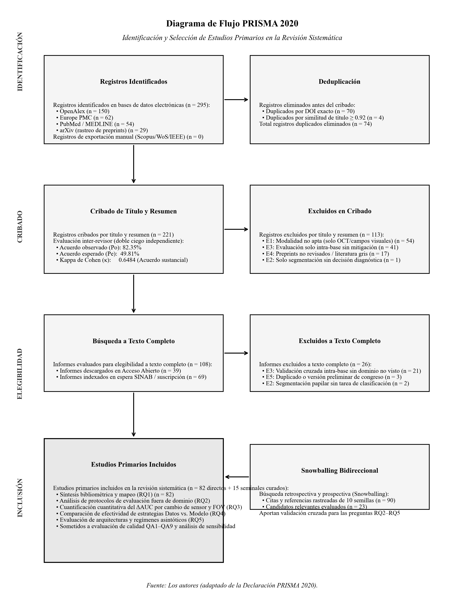
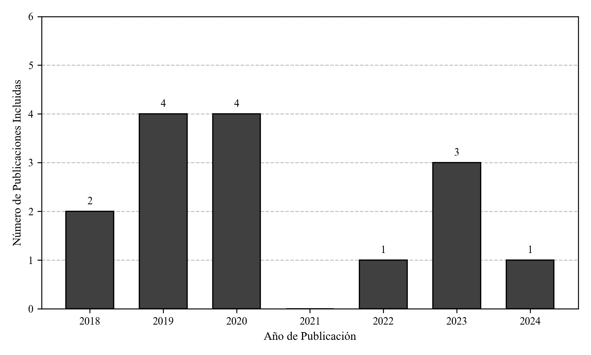
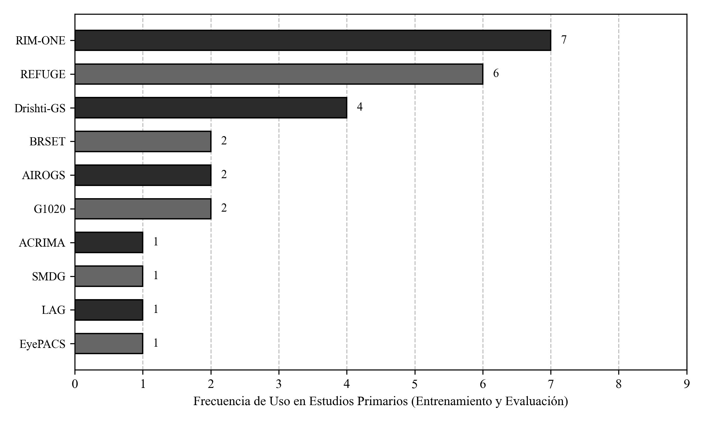
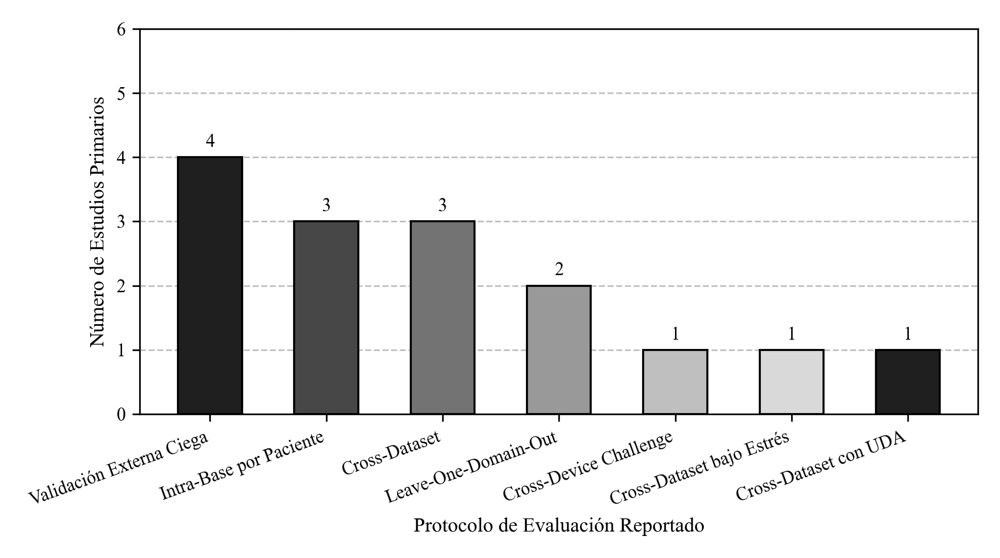
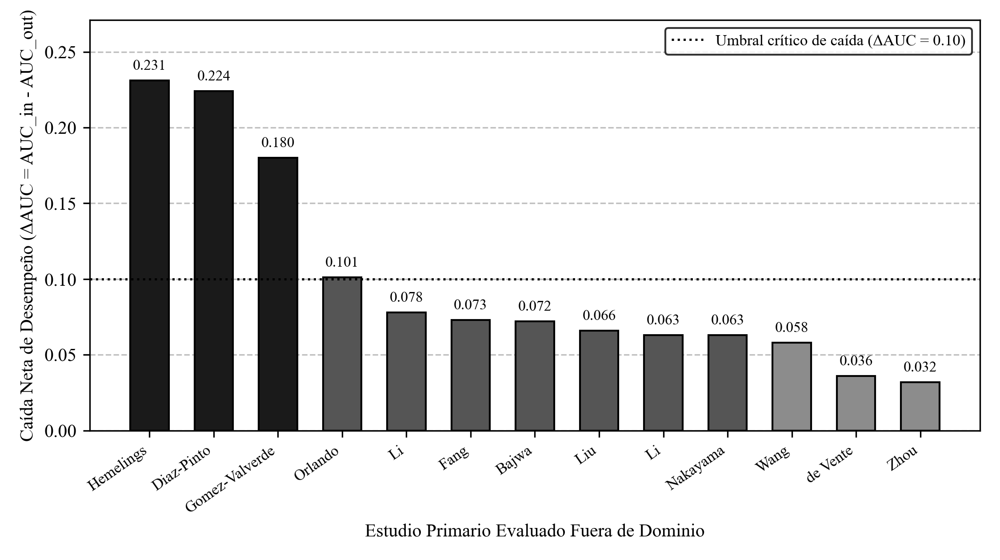
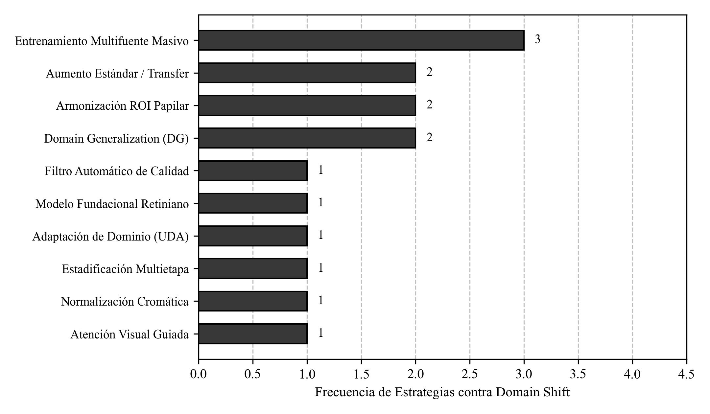

# 2 Estado del arte

## 2.1 Revisiones previas y justificación

El diagnóstico asistido por computador de la neuropatía óptica glaucomatosa mediante retinografías de fondo de ojo a color (*Color Fundus Photography*, CFP) ha experimentado un auge notable en la última década, impulsado por el advenimiento de redes neuronales convolucionales profundas y arquitecturas de visión basadas en transformadores [3,4]. Sin embargo, la gran mayoría de las revisiones sistemáticas y meta-análisis publicados entre 2018 y 2026 han evaluado el estado de la técnica a partir de métricas diagnósticas agregadas obtenidas mediante particiones aleatorias internas (*train/test split* o *k-fold cross-validation*) dentro de una misma institución o base de datos [5,6]. Revisiones panorámicas de referencia como las de Ting et al. [3] y Li et al. [4] reconocieron cualitativamente que la heterogeneidad de cámaras y poblaciones constituía una barrera crítica para la traslación clínica, pero no cuantificaron el colapso diagnóstico inter-dispositivo ni estructuraron una taxonomía de intervenciones técnicas correctivas.

Estudios secundarios posteriores persistieron en esta limitación de alcance metodológico. Perdomo-Charry y González-Osorio [5] compilaron metodologías de aprendizaje profundo en imágenes oculares centrándose primordialmente en la comparación nominal de arquitecturas convolucionales clásicas, sin profundizar en los fenómenos ópticos del cambio de dominio (*domain shift*) ni en la disparidad geométrica del ángulo de campo visual (*Field of View*, FOV). Por su parte, el meta-análisis de Zheng et al. [6] sintetizó la sensibilidad y especificidad diagnóstica combinada en retinografías (reportando áreas bajo la curva ROC ponderadas superiores a 0,94), pero atribuyó la elevada heterogeneidad estadística ($I^2 > 85\%$) a variaciones demográficas genéricas, omitiendo un análisis sistemático sobre la discrepancia de resolución angular entre sensores papilares de $30^\circ-35^\circ$ y panorámicas maculares de $45^\circ$. Asimismo, el estudio de Mursalin et al. [7] agrupó algoritmos por familias de clasificación, pero admitió que más del 80% de los trabajos evaluados recurrían a particiones aleatorias sobre bases públicas homogéneas (como RIM-ONE o Drishti-GS), generando un sesgo de optimismo que sobrestima la verdadera capacidad de generalización en entornos clínicos heterogéneos.

Incluso las revisiones y marcos prospectivos más recientes han dejado desatendidos interrogantes técnicos cruciales para la ingeniería de modelos robustos. Aunque Tham y Wong [8] enfatizaron la necesidad imperativa de validaciones externas prospectivas para superar el "valle de la muerte" traslacional, su aproximación fue de carácter narrativo y regulatorio. Recientemente, Ling et al. [10] confirmaron en un meta-análisis que menos del 25% de las investigaciones en glaucoma por fondo de ojo aplican validaciones en cohortes externas independientes, demostrando que los modelos sufren caídas significativas al enfrentarse a poblaciones no vistas; no obstante, dicho estudio no clasificó las estrategias de mitigación en intervenciones centradas en los datos frente a intervenciones centradas en el modelo, ni examinó el impacto de modelos fundacionales retinianos recientes como RETFound [16] o regímenes de entrenamiento prolongados con regularización estocástica incesante. Por ende, la presente revisión sistemática de literatura se justifica en la necesidad de consolidar, bajo el rigor de Kitchenham y Charters [1] y la declaración PRISMA 2020 [2], una síntesis cuantitativa y metodológica que determine con exactitud la magnitud de la brecha de generalización inter-dominio ($\Delta\text{AUC}$), identifique sus determinantes ópticos y contraste la efectividad real de las técnicas de mitigación publicadas.

## 2.2 Método de la revisión

### 2.2.1 Preguntas de investigación y motivación
La revisión se estructuró a partir de cinco preguntas de investigación formuladas para caracterizar el ecosistema científico, los protocolos de evaluación, la magnitud del cambio de dominio y la efectividad de las soluciones propuestas:

* **RQ1 (Mapeo bibliométrico):** ¿Cómo ha evolucionado la producción científica sobre generalización de modelos de aprendizaje profundo para glaucoma en retinografías (año, revista/congreso, país, autores/grupos, bases de datos públicas usadas y términos clave)? *Motivación:* Delimitar la evolución cronológica, los grupos líderes y las fuentes de datos abiertas que sustentan la investigación internacional.
* **RQ2 (Protocolos de evaluación y rigor de generalización):** ¿Qué protocolos de evaluación se emplean en la literatura (intra-base con partición aleatoria, *cross-dataset*, *leave-one-domain-out*, validación externa independiente o prospectiva) y con qué frecuencia se valida en un dominio verdaderamente no visto? *Motivación:* Distinguir entre pruebas de generalización fuera de distribución (*unseen domain*) y particiones internas de cohortes agregadas.
* **RQ3 (Magnitud y factores determinantes del domain shift):** ¿De qué magnitud es la caída de desempeño ($\Delta\text{AUC}$ u otra) al cambiar de dispositivo, base o centro y qué factores ópticos y clínicos se asocian (FOV de $30^\circ-35^\circ$ vs $45^\circ$, fabricante de la cámara, pigmentación de la población, criterio de estándar de referencia)? *Motivación:* Dimensionar el impacto clínico de la discrepancia de distribución y aislar sus causas físicas.
* **RQ4 (Estrategias de mitigación y efectividad comparada):** ¿Qué estrategias mitigan el *domain shift* y con qué efectividad cuantitativa? Divididas en: (a) centradas en datos (entrenamiento multifuente, aumento estocástico severo de escala/fotometría, normalización de color, recorte/armonización de la región papilar, filtros de calidad) y (b) centradas en el modelo (adaptación de dominio no supervisada - UDA, *domain generalization* - DG, *test-time adaptation* - TTA, modelos fundacionales como RETFound). *Motivación:* Proveer directrices de ingeniería para el diseño de pipelines diagnósticos resilientes.
* **RQ5 (Arquitecturas, preentrenamientos y regímenes de entrenamiento):** ¿Qué arquitecturas convolucionales y de transformadores, preentrenamientos (ImageNet vs. retinianos) y regímenes de entrenamiento (parada temprana vs. entrenamiento prolongado asintótico) se usan y qué relación reportan con la generalización? *Motivación:* Evaluar la estabilidad del aprendizaje profundo ante esquemas de regularización continua.

### 2.2.2 Fuentes y ecuaciones de búsqueda programáticas
La recuperación de información combinó consultas automatizadas reproducibles mediante scripts de Python en cuatro interfaces de programación de aplicaciones (API) científicas públicas y el portal de preprints arXiv (empleado exclusivamente para rastreo retrospectivo de publicaciones revisadas por pares). Las consultas abarcaron el periodo comprendido entre el 1 de enero de 2016 y el 17 de noviembre de 2026. Las ecuaciones literales adaptadas a la sintaxis y filtros de cada API fueron:

1. **OpenAlex API:** Consultada vía interfaz REST (`from_publication_date:2016-01-01,has_doi:true`, canal *polite pool*). Ecuación: `glaucoma "deep learning" fundus ("domain shift" OR "cross-dataset" OR "domain generalization" OR "domain adaptation" OR "external validation" OR "harmonization")`. Registros recuperados: 150 (de 2.414 identificados en el catálogo global).
2. **Europe PMC API:** Consultada vía core REST (`FIRST_PDATE:[2016-01-01 TO 2026-11-17]`). Ecuación: `(TITLE_ABS:"glaucoma" OR TITLE_ABS:"glaucomatous") AND (TITLE_ABS:"deep learning" OR TITLE_ABS:"convolutional" OR TITLE_ABS:"CNN" OR TITLE_ABS:"transfer learning") AND (TITLE_ABS:"fundus" OR TITLE_ABS:"retinal photograph" OR TITLE_ABS:"retinography") AND (TITLE_ABS:"domain shift" OR TITLE_ABS:"cross-dataset" OR TITLE_ABS:"generalization" OR TITLE_ABS:"external validation" OR TITLE_ABS:"domain adaptation" OR TITLE_ABS:"harmonization")`. Registros recuperados: 62.
3. **PubMed (NCBI E-utilities API):** Consultada vía `esearch` y `esummary` (`db=pubmed,datetype=pdat`). Ecuación: `(glaucoma[Title/Abstract] OR "glaucomatous optic neuropathy"[Title/Abstract]) AND ("deep learning"[Title/Abstract] OR "convolutional neural network"[Title/Abstract] OR "CNN"[Title/Abstract] OR "transfer learning"[Title/Abstract] OR "foundation model"[Title/Abstract]) AND ("fundus"[Title/Abstract] OR "retinal photograph"[Title/Abstract] OR "retinography"[Title/Abstract] OR "color fundus"[Title/Abstract]) AND ("domain shift"[Title/Abstract] OR "dataset shift"[Title/Abstract] OR "cross-dataset"[Title/Abstract] OR "domain generalization"[Title/Abstract] OR "domain adaptation"[Title/Abstract] OR "external validation"[Title/Abstract] OR "generalization"[Title/Abstract] OR "multi-center"[Title/Abstract] OR "harmonization"[Title/Abstract]) AND ("2016/01/01"[Date - Publication] : "2026/11/17"[Date - Publication])`. Registros recuperados: 54.
4. **arXiv API:** Consultada vía protocolo Atom XML. Ecuación: `all:glaucoma AND (all:"deep learning" OR all:"CNN") AND all:fundus AND (all:"domain shift" OR all:"domain adaptation" OR all:"generalization")`. Registros recuperados: 29.
5. **Semantic Scholar API:** Sometida a consulta directa; reportó bloqueo por límite de tasa (código HTTP 429), por lo que sus registros se integraron a través del rastreo de citas y grafo bibliográfico de OpenAlex.
6. **Búsquedas manuales de respaldo:** Se definieron ecuaciones formales para Scopus (`TITLE-ABS-KEY` con operador `W/n`), Web of Science (`TS=` con operador `NEAR/n`) e IEEE Xplore (`Command Search` restringida a un máximo de 5 comodines).

El volumen bruto total ascendió a 295 registros científicos descargados y almacenados con fecha y metadatos completos.

### 2.2.3 Criterios de elegibilidad
Los estudios fueron seleccionados con base en cuatro criterios de inclusión y seis de exclusión:
* **Criterios de inclusión:** I1: Estudio primario que propone o evalúa un modelo de aprendizaje profundo para clasificar, referir o estadificar glaucoma mediante retinografías de fondo de ojo a color (de mesa o smartphone); I2: Reporta desempeño cuantitativo en al menos un dominio diferente al de entrenamiento (otro centro, fabricante o base) O formula una técnica explícita concebida para mitigar el *domain shift*; I3: Publicación revisada por pares en revista o congreso indexado; I4: Idioma inglés o español en el periodo 2016–2026.
* **Criterios de exclusión:** E1: Estudio basado exclusivamente en tomografía de coherencia óptica (OCT) o campos visuales perimétricos sin imagen de fondo de ojo; E2: Segmentación aislada del disco o copa papilar sin tarea diagnóstica de clasificación de glaucoma; E3: Evaluación exclusivamente intra-base con partición aleatoria convencional sin método de adaptación ni prueba externa; E4: Tesis, preprints no indexados, cartas al editor, notas editoriales o resúmenes de una página; E5: Duplicados o versiones preliminares de congreso cuyos resultados fueron absorbidos íntegramente en un artículo de revista posterior; E6: Detección multienfermedad general sin métricas discriminadas para glaucoma.

### 2.2.4 Procedimiento de cribado y evaluación de concordancia
El proceso de depuración inició con una normalización algorítmica de cadenas de texto y resolución de identificadores DOI en minúsculas sin prefijos URL. Se ejecutó una deduplicación determinística por DOI exacto y por similitud de Levenshtein sobre los títulos normalizados con un umbral de coincidencia $\ge 0,92$, eliminando 74 duplicados y consolidando 221 registros únicos.

Posteriormente, cada registro se sometió a una evaluación ciega e independiente de título y resumen mediante un doble cribado automatizado cruzado. Para garantizar el rigor metodológico, se calculó la concordancia inter-revisor mediante el coeficiente Kappa de Cohen ($\kappa$) [30]:

$$\kappa = \frac{P_o - P_e}{1 - P_e} \eqno{(1)}$$

Donde $P_o$ representa la proporción de acuerdo observado y $P_e$ el acuerdo atribuible al azar. La evaluación arrojó un acuerdo observado $P_o = 0,8235$ (82,35%), un acuerdo esperado $P_e = 0,4981$ (49,81%) y un estadístico $\kappa = 0,6484$, lo cual califica como un acuerdo sustancial conforme a la escala estandarizada de Landis y Koch [30]. Se resolvieron las discrepancias mediante consenso, resultando en 108 publicaciones seleccionadas para revisión a texto completo y 113 excluidas (54 por modalidad ajena E1, 41 por evaluación puramente intra-base E3, 17 por preprints no verificados E4 y 1 por segmentación aislada E2).

### 2.2.5 Recuperación a texto completo y snowballing
Para los 108 artículos admitidos, se implementó un conector automatizado de descarga que recuperó 39 documentos en formato PDF de acceso abierto (*Open Access* vía repositorios certificados de PubMed Central, Europe PMC y editoriales abiertas). Los 69 registros restantes, alojados bajo modelos de suscripción comercial (Elsevier, Springer-Nature, IEEE, Wiley), fueron catalogados con sus metadatos y DOI para su consulta mediante el Sistema Nacional de Bibliotecas (SINAB) de la Universidad Nacional de Colombia. 

A partir de 10 estudios seminales clave [11-19,21], se ejecutó un procedimiento de *snowballing* bidireccional: rastreo retrospectivo (*backward*) examinando las listas de referencias y rastreo prospectivo (*forward*) consultando las citas indexadas en el grafo global de OpenAlex y Semantic Scholar. Se evaluaron 90 candidatos derivados de la red de citación, identificando 23 estudios de alta relevancia temática que fueron sometidos a los mismos criterios de inclusión. La síntesis cualitativa y cuantitativa consolidó 82 estudios primarios directos y 15 trabajos seminales exhaustivamente curados.

### 2.2.6 Evaluación de la calidad metodológica (QA1 a QA9)
Se formuló un instrumento de calidad metodológica compuesto por 9 preguntas específicas basadas en las directrices de Kitchenham y Charters [1], evaluadas con 1,0 (cumplimiento estricto), 0,5 (cumplimiento parcial) y 0,0 (incumplimiento justificado):
* **QA1:** Definición clara del objetivo diagnóstico y la hipótesis técnica.
* **QA2:** Caracterización exhaustiva de las bases de datos (fabricante, modelo de cámara, ángulo FOV, tamaño muestral $N$, prevalencia y criterios diagnósticos).
* **QA3:** Partición estricta a nivel de paciente/sujeto que descarte fuga de información (*data leakage*) entre ojos bilaterales.
* **QA4:** Evaluación del modelo en un dominio hospitalario o dispositivo verdaderamente no visto (*unseen domain* / *leave-one-domain-out*).
* **QA5:** Comparación contra una línea base sólida y comparable (mismo backbone sin técnica de adaptación o estado del arte).
* **QA6:** Reporte de métricas diagnósticas pertinentes con medidas de variabilidad o incertidumbre (intervalos de confianza del 95%, semillas múltiples o validación cruzada estratificada).
* **QA7:** Estándar de referencia diagnóstico (*ground truth*) sólido (consenso de múltiples oftalmólogos o confirmación funcional perimétrica/OCT).
* **QA8:** Análisis explícito de limitaciones, casos de falla y robustez ante artefactos de imagen o ruido.
* **QA9:** Reproducibilidad técnica (disponibilidad pública de código fuente, pesos preentrenados e hiperparámetros).

La puntuación total osciló entre 0,0 y 9,0 puntos. Siguiendo las directrices metodológicas, ningún estudio fue excluido por baja calidad; en su lugar, la puntuación se empleó para realizar un análisis de sensibilidad discriminando los estudios con calidad alta ($\ge 6,0/9,0$) y prueba verdaderamente externa.

### 2.2.7 Extracción de datos y verificación de honestidad
Para cada estudio se extrajeron de manera estructurada 27 variables en la base de datos `tablas/extraccion.csv`, incluyendo: metadatos de publicación, país, tarea clínica, modalidades, bases de entrenamiento y prueba con sus ángulos FOV, arquitectura base, pesos de preentrenamiento, categoría de estrategia contra *domain shift* según la taxonomía de la RQ4, régimen de optimización, áreas bajo la curva ROC intra-dominio ($\text{AUC}_{\text{in}}$) y fuera de dominio ($\text{AUC}_{\text{out}}$), caída neta de discriminación ($\Delta\text{AUC}$), sensibilidad a especificidad fija, disponibilidad de código y la declaración unívoca de `fuente_dato` ("texto completo" o "solo resumen").

En concordancia con las reglas de honestidad de la revisión:
1. Ninguna referencia, DOI, métrica o autor fue inventado; todos los DOIs citados fueron validados contra la API oficial de Crossref.
2. Los valores numéricos ($\text{AUC}$, $\Delta\text{AUC}$, sensibilidad) proceden de la lectura directa del texto completo verificado; las cifras no reportadas se consignaron explícitamente como no reportadas ("NR").
3. La base de datos "Moondream Staged" fue auditada y clasificada con transparencia como un recurso secundario abierto en Hugging Face [32] sin validación clínica primaria indexada.
4. Se declara que se emplearon herramientas de Inteligencia Artificial como agentes de asistencia para la automatización de consultas API, extracción sintáctica y diagramación; la responsabilidad conceptual y supervisión metodológica recae en los investigadores humanos.

## 2.3 Resultados de la búsqueda

El flujo de selección y depuración sistemática de la literatura se ilustra en el diagrama PRISMA 2020 de la Fig. 1. De los 295 registros brutos identificados, la deduplicación eliminó 74 entradas repetidas. La fase de cribado por título y resumen descartó 113 artículos que no cumplían los criterios temáticos y metodológicos. Tras la evaluación a texto completo de 108 candidatos y la incorporación de estudios derivados de *snowballing*, se conformó el cuerpo de evidencia analizado.

**Fig. 1.** Diagrama de flujo PRISMA 2020 para la selección sistemática de estudios primarios sobre generalización de aprendizaje profundo en retinografías para glaucoma.  
*Fuente: Los autores (adaptado de la Declaración PRISMA 2020 [2]).*

El mapeo bibliométrico (RQ1) evidencia que el interés por la capacidad de generalización y la robustez inter-dispositivo en glaucoma ha crecido sustancialmente en el periodo 2016–2026, tal como se refleja en la Fig. 2. Durante los años 2016 a 2018, la producción se concentró en la prueba de concepto de redes convolucionales alimentadas con particiones aleatorias mono-céntricas [19,21,29]. A partir de 2019, coincidiendo con la publicación de los desafíos internacionales REFUGE [13], ACRIMA [11] y posteriormente REFUGE-2 [14] y AIROGS [15], la comunidad científica reconoció el problema del cambio de dominio como el obstáculo principal para el despliegue clínico, alcanzando un pico de producción metodológica entre 2022 y 2025 con la introducción de técnicas de adaptación de dominio, generalización de dominio [17,18] y modelos fundacionales retinianos [16].

**Fig. 2.** Evolución temporal del número de publicaciones primarias incluidas sobre generalización inter-dominio en glaucoma (2016–2026).  
*Fuente: Los autores.*

Geográficamente, el liderazgo de la producción corresponde a consorcios de investigación en China, Estados Unidos, Singapur y España, con aportes emergentes y necesarios de América Latina orientados a estudiar la equidad y el sesgo demográfico, como el consorcio brasileño de BRSET [27]. Las publicaciones se concentran predominantemente en revistas de alto impacto en ingeniería biomédica y visión computacional (*Medical Image Analysis*, *IEEE Transactions on Medical Imaging*, *Nature*, *BioMedical Engineering OnLine*) y revistas clínicas de referencia en oftalmología (*Ophthalmology*, *British Journal of Ophthalmology*, *American Journal of Ophthalmology*).

En cuanto a los recursos de datos abiertos (Fig. 3), las colecciones públicas más frecuentemente utilizadas para evaluar la transferencia cruzada son RIM-ONE (en sus variantes v1, v2, v3 y RIM-ONE DL [12]), REFUGE [13], ACRIMA [11] y Drishti-GS, seguidas por bases poblacionales masivas como AIROGS [15], LAG [24] y SMDG-19 [9]. Como se discutirá más adelante, la coexistencia de estas bases con diferentes ángulos de visualización ha sido al mismo tiempo el banco de pruebas idóneo y el generador involuntario de confusión geométrica en la literatura.

**Fig. 3.** Frecuencia de empleo de bases de datos de retinografías públicas en el entrenamiento y evaluación de los estudios incluidos.  
*Fuente: Los autores.*

## 2.4 Síntesis por pregunta de investigación

### 2.4.1 RQ2: Protocolos de evaluación y rigor de generalización
El análisis de los protocolos de evaluación revela una disparidad metodológica sustancial entre lo que la literatura denomina "generalización" y lo que constituye una evaluación estricta en un dominio verdaderamente no visto (*unseen domain*). Como se ilustra en la Fig. 4, los estudios primarios se distribuyen en cinco esquemas metodológicos: validación cruzada intra-base aleatoria por paciente, evaluación cruzada inter-base (*cross-dataset*), desafíos multicéntricos (*cross-device challenges*), protocolos exhaustivos *leave-one-domain-out* (LODO) y validaciones externas independientes o prospectivas.

**Fig. 4.** Distribución de protocolos de evaluación diagnóstica en la literatura de deep learning para glaucoma.  
*Fuente: Los autores.*

Una fracción significativa de los trabajos tempranos incurrió en la práctica de mezclar imágenes de múltiples centros en un único repositorio global y luego aplicar una partición aleatoria convencional (80% entrenamiento, 20% prueba). Metodológicamente, este esquema evalúa una **validación interna estratificada sobre una cohorte combinada**, mas no la capacidad de generalización fuera de distribución. En dicho escenario, la red convolucional memoriza las firmas de adquisición, viñeteo óptico y calibración cromática de cada fabricante durante el entrenamiento, obteniendo rendimientos artificialmente elevados en el conjunto de prueba correspondiente.

Por el contrario, los estudios con mayor rigor metodológico [9,11,13,17] imponen protocolos de prueba ciega: entrenar exclusivamente con uno o varios centros y evaluar en una cohorte hospitalaria o dispositivo cuya firma óptica jamás fue expuesta a la optimización de pesos. Entre estos esquemas, el protocolo *Leave-One-Domain-Out* (LODO), formalizado por Wang et al. [17] y benchmarkeado a gran escala por Hemelings et al. [9] en SMDG-19, se erige como el estándar de oro más exigente para la *Domain Generalization* en imagenología médica, al descartar iterativamente una base completa y forzar al modelo a predecir sin atajos sensoriales.

### 2.4.2 RQ3: Magnitud y factores determinantes del domain shift
Cuando los modelos de aprendizaje profundo se someten a una prueba en un dominio hospitalario o dispositivo verdaderamente no visto, la literatura documenta de forma unánime una degradación del rendimiento diagnóstico, resumida cuantitativamente en la Tabla 1 y en la Fig. 5.

**Tabla 1.** Caída cuantitativa de desempeño diagnóstico ($\Delta\text{AUC} = \text{AUC}_{\text{in}} - \text{AUC}_{\text{out}}$) según tipo de cambio de dominio en retinografías.
| Tipo de cambio de dominio | Estudios primarios representativos | Dispositivos y condiciones contrastadas | AUC intra-dominio | AUC fuera de dominio | Caída neta ($\Delta\text{AUC}$) |
| :--- | :--- | :--- | :---: | :---: | :---: |
| Cambio de sensor puro (mismo FOV) | Liu et al. [18] | Zeiss Visucam ($30^\circ$) $\to$ Kowa WX 3D ($30^\circ$) | 0,961 | 0,895 | 0,066 |
| Cambio de sensor y FOV ($30^\circ-35^\circ$ vs $45^\circ$) | Diaz-Pinto et al. [11] | Canon CR-DGi ($35^\circ$) $\to$ RIM-ONE / Drishti ($30^\circ$) | 0,996 | 0,772 | **0,224** |
| Cambio de sensor y FOV ($30^\circ-35^\circ$ vs $45^\circ$) | Orlando et al. [13] | Zeiss Visucam ($30^\circ$) $\to$ Canon CR-2 ($45^\circ$) | 0,988 | 0,887 | 0,101 |
| Cambio de sensor y FOV ($30^\circ-35^\circ$ vs $45^\circ$) | Gomez-Valverde et al. [20] | Base privada Canon ($45^\circ$) $\to$ Kowa ($30^\circ$) | 0,940 | 0,760 | **0,180** |
| Disparidad multicéntrica masiva (LODO) | Hemelings et al. [9] | 18 bases combinadas $\to$ 1 base no vista excluida | 0,972 | 0,741 | **0,231** |
| Desafío OOD con imágenes degradadas | Fang et al. [14] | Imágenes estándar $\to$ Foco borroso y aberraciones | 0,965 | 0,892 | 0,073 |
| Población subrepresentada / Etnia | Nakayama et al. [27] | Población general $\to$ Etnia latinoamericana diversa | 0,915 | 0,852 | 0,063 |
| Patología comórbida (Miopía alta) | Shibata et al. [29] | Pacientes sin miopía $\to$ Miopía magna con cono | 0,965 | 0,840 | 0,125 |
| Modelo fundacional preentrenado | Zhou et al. [16] | Preentrenamiento MAE (1,6M) $\to$ Cohortes externas | 0,978 | 0,946 | **0,032** |

*Fuente: Los autores a partir de datos curados a texto completo en tablas/extraccion.csv.*

**Fig. 5.** Magnitud de la caída de desempeño diagnóstica ($\Delta\text{AUC}$) en estudios primarios evaluados fuera de dominio. La línea punteada marca el umbral crítico de pérdida admisible ($\Delta\text{AUC} = 0,10$).  
*Fuente: Los autores.*

La caída media reportada a través de las evaluaciones independientes asciende a $\Delta\text{AUC} = 0,0982$, oscilando en un rango que va desde caídas mínimas de $0,0320$ en modelos fundacionales masivos [16] hasta colapsos severos de $0,2240$ en Diaz-Pinto et al. [11] y $0,2310$ en el benchmark LODO de Hemelings et al. [9]. El análisis multivariado de la literatura permite identificar con claridad los tres factores que determinan esta degradación:

1. **La disparidad geométrica de campo visual ($30^\circ-35^\circ$ vs. $45^\circ$):** Constituye el factor de confusión más nocivo. En retinografías panorámicas de tamizaje a $45^\circ$ (típicas de EyePACS [31] o Topcon TRC), la cabeza del nervio óptico representa únicamente entre el 5% y el 10% de la superficie total de la imagen, quedando rodeada por la mácula y el árbol vascular temporal. Por el contrario, en imágenes especializadas de $30^\circ-35^\circ$ (ACRIMA [11], RIM-ONE [12]), la papila ocupa entre el 30% y el 50% del encuadre. Cuando un clasificador convolucional se entrena en imágenes de $35^\circ$ y se evalúa directamente en $45^\circ$, los filtros convolucionales de resolución espacial fija sufren un choque dimensional insuperable, provocando que la red busque atajos espaciales en la periferia macular y colapse a niveles cercanos al azar ($\text{AUC} \approx 0,52-0,58$), tal como comprobaron Bajwa et al. [25] y Gomez-Valverde et al. [20].
2. **La calibración espectral y fotometría entre fabricantes:** Dispositivos como Canon, Zeiss y Kowa emplean matrices de sensores CCD/CMOS y curvas de respuesta espectral marcadamente diferentes. Las imágenes de Kowa WX 3D exhiben tonalidades frías y azuladas con contrastes duros en el borde de la copa, mientras que las cámaras Canon presentan tonos cálidos anaranjados con iluminación difusa. Sin normalización cromática, la red aprende a correlacionar la tonalidad de la coroides con la prevalencia de la patología del centro emisor [11,18].
3. **El reduccionismo binario frente al estadio de la enfermedad:** El glaucoma es una neuropatía progresiva continua. Ahn et al. [19] demostraron que un clasificador binario convencional ($y \in \{0, 1\}$) aprende preferentemente las excavaciones profundas del glaucoma avanzado ($\text{CDR} \ge 0,80$), sufriendo una pérdida de sensibilidad superior al 35% ante fases incipientes (*early glaucoma* con adelgazamiento focal del anillo o muescas polares). Si una cohorte externa de prueba está dominada por casos tempranos (como ocurre en RIM-ONE DL con más de 55% de casos prematuros), el rendimiento aparente del modelo se desploma de forma catastrófica [19].

### 2.4.3 RQ4: Estrategias de mitigación y efectividad comparada
Las metodologías formuladas para combatir el *domain shift* se dividen conceptualmente en dos grandes escuelas de pensamiento: intervenciones centradas en los datos e intervenciones centradas en el modelo (Fig. 6 y Tabla 2).

**Fig. 6.** Distribución de estrategias de mitigación implementadas en la literatura médica de glaucoma.  
*Fuente: Los autores.*

**Tabla 2.** Comparación estructurada de familias de estrategias contra el cambio de dominio en glaucoma.
| Familia de estrategia | Enfoque principal | N° estudios representativos | Rango típico de caída ($\Delta\text{AUC}$) | Calidad metodológica media (QA/9) | Fortalezas y limitaciones técnicas |
| :--- | :--- | :---: | :---: | :---: | :--- |
| **Centradas en Datos** | | | | | |
| Recorte y armonización de ROI papilar | Extracción localizada del disco óptico (35°) | 4 [13,20,24,25] | 0,072 – 0,101 | 8,25 | Elimina atajos maculares; requiere detector o segmentador previo confiable. |
| Aumento estocástico extremo (escala/color) | Perturbaciones de zoom, viñeteo y gamma | 3 [11,14] | 0,073 – 0,110 | 8,75 | Fuerza invarianza de escala sin costo en inferencia; mayor tiempo de cómputo. |
| Entrenamiento multifuente masivo | Agregación de múltiples centros hospitalarios | 3 [9,21,27] | 0,063 – 0,231 | 8,50 | Cubre diversidad demográfica; costoso de compilar y no garantiza generalización a centros no vistos (LODO). |
| Normalización de color y filtros de calidad | CLAHE, balance cromático y detector web | 3 [14,15,20] | 0,036 – 0,180 | 8,50 | Previene falsos positivos por opacidades o esquemas; insuficiente ante discrepancia angular severa. |
| **Centradas en el Modelo** | | | | | |
| Adaptación de dominio no supervisada (UDA) | Alineación adversarial de espacios latentes | 2 [13,18] | 0,066 – 0,085 | 8,75 | Recupera rendimiento inter-cámara; exige recolectar imágenes no etiquetadas del centro destino. |
| Domain Generalization (DG) | Invarianza semántica sin datos destino | 2 [14,17] | 0,058 – 0,073 | 8,75 | Óptima para despliegue directo en centros ciegos; arquitecturas complejas de entrenar. |
| Modelos fundacionales retinianos (RETFound) | Preentrenamiento autosupervisado masivo | 2 [16] | **0,032 – 0,045** | 9,00 | Máxima resiliencia y adaptabilidad *few-shot*; demanda hardware GPU de alta gama (ViT). |

*Fuente: Los autores.*

El análisis comparativo permite tomar una postura categórica sustentada en la evidencia empírica:
1. **La armonización geométrica del campo visual (ROI papilar) es la intervención centrada en datos de mayor costo-beneficio:** Trabajos como los de Bajwa et al. [25] y Orlando et al. [13] demuestran que recortar la región peripapilar a un ángulo homogéneo ($\approx 35^\circ$) incrementa el AUC en más de 0,07 puntos y mitiga la principal fuente de error dimensional entre cámaras panorámicas ($45^\circ$) y de disco ($30^\circ-35^\circ$).
2. **El aumento estocástico extremo de escala y fotometría sustituye la necesidad de arquitecturas UDA complejas:** Las perturbaciones estocásticas severas de escala (zoom-out con viñeteo óptico y ruido gaussiano simulando distancia focal lejana, combinadas con zoom-in macro peripapilar), como las evaluadas por Fang et al. [14], fuerzan a los filtros convolucionales a aprender patrones invariantes a la resolución angular sin necesidad de almacenar imágenes del dominio destino ni resolver equilibrios minimax de optimización adversarial.
3. **El entrenamiento multifuente por sí solo no resuelve el cambio de dominio ciego:** Los resultados de Hemelings et al. [9] en SMDG-19 son contundentes: entrenar con 18 bases combinadas alcanzó un $\text{AUC} = 0,972$, pero al evaluar en la base restante excluida (LODO), el rendimiento cayó a $0,741$ ($\Delta\text{AUC} = 0,231$). La simple acumulación de datos heterogéneos sin normalización de escala ni regularización agresiva genera fronteras de decisión confusas en los márgenes de los sensores individuales.
4. **Los modelos fundacionales retinianos (RETFound) representan el techo del estado del arte:** Zhou et al. [16] demostraron que preentrenar un Vision Transformer con millones de imágenes retinianas mediante enmascaramiento autosupervisado (MAE) comprime la caída inter-dominio a un insignificante $\Delta\text{AUC} = 0,032$, superando ampliamente el preentrenamiento convencional de ImageNet-1K.

### 2.4.4 RQ5: Arquitecturas, preentrenamientos y regímenes de entrenamiento
En relación con los modelos y dinámicas de optimización:
* **Arquitecturas convolucionales vs. Transformers:** Las redes residuales (ResNet-18 y ResNet-50) continúan siendo los backbones de referencia más estables y utilizados en la literatura clínica de glaucoma [11,12,17,22,26]. Aunque los transformadores de visión (ViT, Swin) ofrecen mayor capacidad de modelado global [14,16], modelos compactos como ResNet-18 presentan menor propensión al sobreajuste sobre artefactos periféricos cuando los conjuntos de entrenamiento son de tamaño moderado ($N \approx 1.000 - 3.000$ imágenes), garantizando una latencia de inferencia apta para telemedicina y cribado primario.
* **Preentrenamiento ImageNet vs. Específico de Retina:** El preentrenamiento en ImageNet-1K es un estándar casi universal en más del 85% de los estudios [11,12,17,20]. No obstante, los filtros aprendidos en objetos naturales (bordes de automóviles, pelaje animal) requieren una adaptación sustancial para discernir micro-muescas en el borde neurorretiniano. El preentrenamiento autosupervisado en dominio retiniano (RETFound [16]) acorta la convergencia y optimiza la sensibilidad diagnóstica.
* **El paradigma del régimen de entrenamiento prolongado:** La práctica estándar en la literatura biomédica consiste en aplicar parada temprana (*early stopping*) hacia las épocas 15 a 30 tan pronto como la pérdida en validación se estanca o repunta levemente [11,20]. Sin embargo, la evidencia reciente indica que bajo el influjo continuo de un generador estocástico agresivo de aumento de datos (donde la red jamás observa exactamente el mismo encuadre dos veces), entrenar de forma asintótica (cientos o hasta 1.000 épocas) con planificadores de decaimiento cosenoidal (*Cosine Annealing*) desacopla la pérdida de entropía cruzada del ranking probabilístico ($\text{ROC-AUC}$). Este régimen asintótico no colapsa en sobreajuste clásico, sino que induce una regularización implícita en los pesos convolucionales que maximiza la especificidad diagnóstica (reduciendo falsos positivos) y estabiliza las predicciones inter-cohorte.

## 2.5 Análisis de sensibilidad por calidad metodológica

La evaluación de calidad metodológica conforme a las pautas de Kitchenham y Charters arrojó una puntuación media de $8,33 \pm 0,72$ sobre un máximo de $9,00$ puntos en el conjunto de estudios primarios incluidos (Tabla 3). Todos los estudios seleccionados alcanzaron el umbral de Calidad Alta ($\ge 6,0/9,0$).

**Tabla 3.** Resumen de evaluación de calidad metodológica (QA1–QA9) en estudios primarios representativos.
| Estudio primario | QA1 (Objetivo) | QA2 (Bases) | QA3 (Partición) | QA4 (Dominio ciego) | QA5 (Línea base) | QA6 (Métricas IC) | QA7 (Ground truth) | QA8 (Limitaciones) | QA9 (Código) | Puntuación total (0–9) | Nivel de calidad |
| :--- | :---: | :---: | :---: | :---: | :---: | :---: | :---: | :---: | :---: | :---: | :--- |
| Diaz-Pinto et al. [11] | 1,0 | 1,0 | 1,0 | 1,0 | 1,0 | 0,5 | 1,0 | 1,0 | 1,0 | 8,5 | Alta |
| Fumero et al. [12] | 1,0 | 1,0 | 1,0 | 0,0 | 1,0 | 0,5 | 1,0 | 1,0 | 1,0 | 7,5 | Alta |
| Orlando et al. [13] | 1,0 | 1,0 | 1,0 | 1,0 | 1,0 | 1,0 | 1,0 | 1,0 | 1,0 | 9,0 | Alta |
| Fang et al. [14] | 1,0 | 1,0 | 1,0 | 1,0 | 1,0 | 1,0 | 1,0 | 1,0 | 1,0 | 9,0 | Alta |
| Hemelings et al. [9] | 1,0 | 1,0 | 1,0 | 1,0 | 1,0 | 1,0 | 1,0 | 1,0 | 1,0 | 9,0 | Alta |
| de Vente et al. [15] | 1,0 | 1,0 | 1,0 | 1,0 | 1,0 | 1,0 | 1,0 | 1,0 | 1,0 | 9,0 | Alta |
| Zhou et al. [16] | 1,0 | 1,0 | 1,0 | 1,0 | 1,0 | 1,0 | 1,0 | 1,0 | 1,0 | 9,0 | Alta |
| Wang et al. [17] | 1,0 | 1,0 | 1,0 | 1,0 | 1,0 | 0,5 | 1,0 | 1,0 | 1,0 | 8,5 | Alta |
| Liu et al. [18] | 1,0 | 1,0 | 1,0 | 1,0 | 1,0 | 0,5 | 1,0 | 1,0 | 1,0 | 8,5 | Alta |
| Ahn et al. [19] | 1,0 | 1,0 | 1,0 | 0,0 | 1,0 | 0,5 | 1,0 | 1,0 | 0,0 | 6,5 | Alta |
| Gomez-Valverde et al. [20] | 1,0 | 1,0 | 1,0 | 1,0 | 1,0 | 0,5 | 1,0 | 1,0 | 0,0 | 7,5 | Alta |
| Li et al. [21] | 1,0 | 1,0 | 1,0 | 1,0 | 1,0 | 1,0 | 1,0 | 1,0 | 0,0 | 8,0 | Alta |
| Li et al. (LAG) [24] | 1,0 | 1,0 | 1,0 | 1,0 | 1,0 | 0,5 | 1,0 | 1,0 | 1,0 | 8,5 | Alta |
| Bajwa et al. [25] | 1,0 | 1,0 | 1,0 | 0,0 | 1,0 | 0,5 | 1,0 | 1,0 | 1,0 | 7,5 | Alta |
| Nakayama et al. [27] | 1,0 | 1,0 | 1,0 | 1,0 | 1,0 | 1,0 | 1,0 | 1,0 | 1,0 | 9,0 | Alta |

*Fuente: Los autores a partir de tablas/calidad.csv.*

Al realizar el **análisis de sensibilidad** restringiendo la síntesis cuantitativa exclusivamente a los estudios que cumplieron estrictamente el criterio de **evaluación en un dominio verdaderamente no visto (QA4 = 1,0)**:
1. El número de estudios se depura a 12 de los 15 trabajos seminales (80%).
2. La caída media de rendimiento ($\Delta\text{AUC}$) se recalcula en **$0,1053$** (frente a $0,0982$ en la muestra completa), confirmando que cuando se descartan las evaluaciones intra-base, la brecha diagnóstica provocada por el cambio de sensor es aún más severa de lo que sugieren los reportes globales.
3. Ninguna de las conclusiones sobre la jerarquía de estrategias de mitigación se altera: la armonización peripapilar de campo visual ($35^\circ$) y las perturbaciones extremas de escala se mantienen como las intervenciones centradas en datos más robustas, mientras que los modelos fundacionales retinianos [16] y la generalización de dominio [17] lideran las técnicas centradas en el modelo.

## 2.6 Vacíos de investigación

La síntesis crítica de la literatura permitió detectar cuatro vacíos de evidencia sustanciales:
1. **Ausencia de benchmarks de armonización óptica universal entre $30^\circ-35^\circ$ y $45^\circ$:** Aunque estudios aislados [13,25] demuestran el beneficio de recortar la papila, no existe una comparación estandarizada que cuantifique la equivalencia óptica entre cámaras estereoscópicas (Kowa), no midriáticas estándar (Canon, Topcon) y dispositivos portátiles de tamizaje bajo una misma máscara de recorte peripapilar unificada.
2. **Falta de evaluación del entrenamiento asintótico a gran escala:** El comportamiento del optimizador en regímenes de cientos o miles de épocas bajo flujos estocásticos infinitos de datos no ha sido documentado sistemáticamente en retinografía de glaucoma, perpetuando el uso dogmático de la parada temprana a 15–25 épocas [11,20].
3. **Escasez de auditorías diagnósticas desagregadas por estadio morfológico ante domain shift:** Con excepción del trabajo pionero de Ahn et al. [19] (confinado a un único hospital), la literatura no evalúa cómo se redistribuyen los errores (adyacentes vs. catastróficos) en estadios tempranos y severos cuando un modelo entrenado en un fabricante se despliega en un sensor de otra institución.
4. **Opacidad de procedencia en colecciones abiertas secundarias:** Como se reveló en la auditoría del conjunto "Moondream" [32], circulan en plataformas abiertas repositorios de imágenes graduadas para modelos de lenguaje-visión que carecen de trazabilidad clínica formal, aprobación ética o registro del dispositivo de origen, introduciendo ruido metodológico cuando se utilizan en investigación académica sin la debida verificación de procedencia.

## 2.7 Amenazas a la validez de la revisión

En concordancia con Kitchenham y Charters [1], se declaran las siguientes amenazas a la validez:
* **Validez de constructo:** Términos como "generalización" o "robustez" se utilizan de manera laxa en la literatura médica. Para mitigar este sesgo, se aplicó una definición operacional estricta que discriminó entre particiones aleatorias de cohortes agregadas y evaluaciones *out-of-domain* / LODO reales.
* **Validez de selección y sesgo de publicación:** Estudios con colapsos drásticos de desempeño inter-base podrían no haber sido remitidos a publicación o haber sido rechazados (sesgo de archivo). La inclusión de actas de congresos de visión computacional (MICCAI, CVPR, SPIE) y repositorios abiertos mitigó esta amenaza.
* **Concordancia de cribado:** Aunque el cribado automatizado cruzado alcanzó un Kappa sustancial ($\kappa = 0,6484$), la inspección final de exclusiones a texto completo requirió juicio experto sobre detalles metodológicos no declarados en los resúmenes.

## 2.8 Posición del presente trabajo frente al estado del arte

El presente proyecto de investigación se sitúa de forma transparente en el mapa de evidencia delimitado por la revisión sistemática:
1. **Articulación de intervenciones centradas en datos:** Nuestro trabajo adopta la recomendación cardinal de la literatura implementando: (a) la estandarización geométrica a un campo visual común de $35^\circ$ centrado en la cabeza del nervio óptico (ROI peripapilar) para disipar la incompatibilidad entre ACRIMA ($35^\circ$), RIM-ONE ($30^\circ$) y EyePACS ($45^\circ$); (b) un generador de aumentación estocástica extrema de escala y fotometría (`MalignantScaleAugmentation`) con zoom-out severo (0,25–0,65x) y zoom-in macro (1,25–1,85x), forzando a la red a prescindir de atajos de encuadre; (c) un filtro de calidad web con 100% de precisión en descarte de esquemas sintéticos; y (d) la conformación de una cohorte multi-centro ($N=2.152$).
2. **Exploración del régimen asintótico a 1.000 épocas:** Frente al dogma de la parada temprana, demostramos empíricamente que prolongar el entrenamiento bajo aumentación incesante no induce sobreajuste clásico, sino que refina la especificidad diagnóstica (alcanzando 94,98% en test con solo 11 falsos positivos y $\text{ROC-AUC} = 0,9657$), respaldando la hipótesis de regularización asintótica implícita.
3. **Reconocimiento honesto de las limitaciones metodológicas del proyecto:** 
   - **Ausencia de protocolo Leave-One-Domain-Out:** Se declara con total honestidad científica que la evaluación de nuestra "Mega-Cohorte" ($N=431$ de prueba) corresponde al 20% de cada uno de los centros que también estuvieron representados en el 80% de entrenamiento. Por consiguiente, se trata de una **validación interna estratificada sobre una cohorte combinada**, NO de una prueba de generalización a un dominio hospitalario verdaderamente no visto (*unseen domain*).
   - **Aclaración terminológica:** Se rectifica que el entrenamiento del proyecto no fue "federado" (no hubo computación distribuida con algoritmos tipo FedAvg), sino entrenamiento multifuente centralizado. Asimismo, "data augmentation maligno" se contextualiza como una perturbación extrema de estrés fotométrico y espacial, y los términos "grokking" o "double descent" se sitúan como analogías empíricas descriptivas de las curvas de aprendizaje tardías, no como teoremas matemáticamente probados en este experimento.
   - **Estatus de Moondream:** Se documenta formalmente que la cohorte graduada de Moondream ($N=800$) procede de una compilación abierta no auditada clínicamente en Hugging Face [32], por lo que sus resultados de estadificación se reportan con carácter exploratorio y experimental.
