# Fase F1 — Estructura Final y Mapa Conceptual del Marco Teórico

**Ubicación en el manuscrito:** Sección `2 Marco teórico` (precede a `3 Estado del arte`, con numeración única y compartida de referencias `[1]..[N]` en orden de aparición).  
**Convención DYNA:** Encabezados en formato oración (*sentence case*), máximo 3 niveles (`2`, `2.1`, `2.1.1`), numeración arábiga sin punto final tras el número.  
**Frontera estricta con `3 Estado del arte`:** Aquí se expone únicamente teoría consolidada (libros, artículos fundacionales y revisiones metodológicas canónicas). Los trabajos de *deep learning* en glaucoma de 2016–2026 (`RETFound`, `REFUGE`, `AIROGS`, `DoFE`, `SMDG-19`, etc.) y los resultados empíricos del repositorio permanecen en el Estado del Arte y en Experimentos/Resultados, salvo la cita puntual de `ACRIMA` y `RIM-ONE DL` para ilustrar diferencias de encuadre y criterio de etiqueta.

---

## 1. Desglose por subsecciones (`2.1`–`2.6`)

### `2.1 El glaucoma y su expresión en la retinografía`
* **Contenido:**
  * Definición fisiopatológica: neuropatía óptica progresiva, degeneración de células ganglionares retinianas y curso asintomático inicial (`Weinreb 2014` ✅).
  * Carga epidemiológica global y regional (40–80 años: prevalencia global 3.54%, América Latina y el Caribe 4.51%, 64.3 M en 2013 a 111.8 M en 2040; `Tham 2014` ✅).
  * Biomarcadores estructurales en fotografía de fondo de ojo: excavación papilar, relación copa-disco vertical ($\text{VCDR}$, `ec. (1)`), adelgazamiento del anillo neurorretiniano, regla ISNT (`Abràmoff 2010` ✅; `Harizman 2006` ⬜) y estadificación morfológica por daño del anillo / DDLS (`Spaeth 2002` ⬜).
  * Naturaleza de la etiqueta diagnóstica (binaria, referible, estadificación ordinal) y estándar de referencia (inspección de fondo vs. confirmación funcional/OCT), destacando cómo las colecciones públicas difieren simultáneamente en encuadre y criterio de etiquetado (`Diaz-Pinto 2019` ✅; `Fumero Batista 2020` ✅).

### `2.2 Formación de la imagen retiniana y fuentes de heterogeneidad`
* **Contenido:**
  * Óptica de la retinografía a color (`Abràmoff 2010` ✅): trayectorias separadas de iluminación y captura a través de la pupila (2–8 mm), respuesta espectral RGB del sensor y contraste del canal verde en microvasculatura/disco.
  * **Campo de visión (FOV) del dispositivo frente a encuadre de la base de datos:** contraste entre fotografía de campo completo centrada en la mácula y recorte peripapilar centrado en el disco óptico (`Diaz-Pinto 2019` ✅; `Fumero Batista 2020` ✅).
  * Modelo generativo de adquisición $\mathbf{x} = \mathcal{A}_d(\mathbf{s}) + \boldsymbol{\varepsilon}$ (`ec. (2)`): óptica/resolución, iluminación y viñeteo, respuesta espectral de cámara, curva gamma y compresión; breve párrafo sobre calidad de imagen (desenfoque, opacidades, artefactos no retinianos).
  * **Definición explícita de "heterogeneidad de adquisición":** variabilidad conjunta introducida por la captura física (dispositivo, óptica, respuesta espectral, iluminación, compresión) y por la conformación de la base (encuadre/recorte y resolución). *Nota de coherencia causal:* el criterio de etiqueta (*concept shift*) y la prevalencia (*label shift*) covarían con cada base, pero se modelan como **moderadores** externos (`2.4` y `2.6`), no dentro de la definición física de adquisición (`Castro 2020` ✅).

### `2.3 Aprendizaje profundo para clasificación de imágenes`
* **Contenido:**
  * Minimización del Riesgo Empírico (ERM, `ec. (3)`, `Chapelle 2000` ✅; `Goodfellow 2016` ✅).
  * Convolución discreta 2D y sesgo inductivo: localidad y **equivarianza a la traslación, pero NO a la escala**, fundamento teórico de la vulnerabilidad ante cambios de encuadre (`Goodfellow 2016` ✅).
  * Arquitecturas convolucionales: bloque residual (`He 2016` ✅, `ec. (4)`) y convoluciones modernas de núcleo amplio con normalización por capas (`ConvNeXt`, `Liu 2022` ✅).
  * Contraste neutral con arquitecturas de autoatención (`Vaswani 2017` ✅; `ViT`, `Dosovitskiy 2021` ✅; `Swin`, `Liu 2021` ✅): menor sesgo inductivo espacial inherente en ViT plano frente a ventanas locales desplazadas en Swin, sin afirmar superioridad a priori de las CNN.
  * Pérdidas y optimización: entropía cruzada binaria (`ec. (5)`) y categórica (`ec. (6)`), clasificación ordinal frente a nominal; `AdamW` (`Loshchilov & Hutter 2019` ✅), *Cosine Annealing* (`Loshchilov & Hutter 2017` ✅, `ec. (7)`), parada temprana y *transfer learning* desde ImageNet (`Yosinski 2014` ✅; `Deng 2009` ⬜).

### `2.4 Generalización y cambio de dominio`
* **Contenido:**
  * Generalización, sobreajuste y regularización; breve referencia a *double descent* (`Nakkiran 2020` ✅) y *grokking* (`Power 2022` ✅) **únicamente como fenómenos documentados de referencia** en la literatura (nunca como resultados demostrados por el proyecto).
  * Taxonomía del cambio de distribución (`ec. (8)`): *covariate shift*, *label/prevalence shift* (relevante en tareas diagnósticas anticausales $y \to \mathbf{x}$), *concept/annotation shift* y *acquisition shift* (`Castro 2020` ✅; `Moreno-Torres 2012` ⬜; `Shimodaira 2000` ⬜).
  * Cota de generalización entre dominios de Ben-David et al. (`2010` ✅, `ec. (9)`): error objetivo acotado por error fuente + divergencia $\mathcal{H}\Delta\mathcal{H}$ + error conjunto ideal.
  * **Adaptación de dominio vs. Generalización de dominio** (`Zhou 2023` ✅): distinción metodológica estricta; solo es válido afirmar generalización cuando se evalúa en un dominio completamente no visto en entrenamiento (`Gulrajani & Lopez-Paz 2021` ✅).
  * Aprendizaje por atajos (*shortcut learning*, `Geirhos 2020` ✅; caso hospitalario `Zech 2018` ✅): riesgo de atajo `fuente → etiqueta` cuando la prevalencia o el preprocesamiento (recorte/color) difieren entre cohortes.
  * Invarianza inducida por datos: riesgo vicinal (`Chapelle 2000` ✅; `Zhang 2018` ✅), aumento de datos (`Shorten & Khoshgoftaar 2019` ✅), normalización cromática (mencionando a `Reinhard 2001` ⬜ solo como inspiración conceptual cuando la implementación usa estandarización RGB fija) y recorte de ROI. *(Sin bloque de Grad-CAM).*

### `2.5 Evaluación de clasificadores diagnósticos y toma de decisiones clínicas` *(Prioritaria para redacción inicial en F5)*
* **`2.5.1 Matriz de confusión, tasas operativas y F1`:** Definiciones y ecuaciones (`ec. (10)`–`(13)`) de $\text{TPR}$ (sensibilidad), $\text{TNR}$ (especificidad), $\text{FPR}$ ($\text{TFP} = 1 - \text{TNR}$), $\text{FNR}$ ($\text{TFN} = 1 - \text{TPR}$) y $F_1$ (`Fawcett 2006` ✅; `Trevethan 2017` ✅).
* **`2.5.2 Curva ROC, AUC y sus límites operativos`:** Construcción de la curva ROC, equivalencia probabilística de la AUC con el estadístico de Wilcoxon–Mann–Whitney (`ec. (14)`, `Fawcett 2006` ✅) y limitaciones clínicas: integra sobre regiones de falsos positivos inviables, ignora costos diferenciales y puede contradecir la utilidad clínica (`Vickers & Elkin 2006` ✅); necesidad de sensibilidad a especificidad fija y AUC parcial.
* **`2.5.3 Umbral operativo, costos asimétricos y beneficio neto`:** Índice de Youden ($J = \text{Se} + \text{Sp} - 1$, `ec. (15)`, `Habibzadeh 2016` ✅) y su supuesto implícito de costos simétricos; decisión óptima de Bayes bajo matriz de costos asimétricos (`ec. (16)`, umbral $p^* \neq 0.5$, `Elkan 2001` ✅); evaluación por beneficio neto mediante curvas de decisión (`Vickers & Elkin 2006` ✅).
* **`2.5.4 Prevalencia y valores predictivos`:** Relación bayesiana de VPP y VPN con sensibilidad, especificidad y prevalencia (`ec. (17)`–`(18)`, `Trevethan 2017` ✅; `Parikh 2008` ✅). Incluye un **ejemplo numérico ilustrativo declarado explícitamente como tal** comparando una cohorte balanceada de laboratorio (50%) frente a tamizaje poblacional (prevalencia 3.54% de `Tham 2014` ✅).
* **`2.5.5 Calibración de probabilidades y transferencia bajo cambio de dominio`:** Sobreconfianza en redes profundas modernas, ECE y *temperature scaling* (`Guo 2017` ✅); invalidez de transferir un umbral $\tau$ fijo del dominio fuente al dominio objetivo ante cambios de calibración o de prevalencia (*label shift*, `Lipton 2018` ✅; `Saerens 2002` ⬜).
* **`2.5.6 Criterios de tamizaje, evaluación ordinal y rigor de validación`:** Principios de tamizaje (`Wilson & Jungner 1968` ✅) y evidencia/controversia actual en glaucoma (`USPSTF / Mangione 2022` ✅: Grado I), precisando que priorizar la reducción de TFN es una **decisión de diseño dependiente del escenario asistencial**, no un mandato universal. Índice kappa cuadrático ponderado ($\text{QWK}$, `ec. (19)`, `Landis & Koch 1977` / `Cohen 1968` ⬜) para distinguir errores adyacentes de catastróficos. Validación interna vs. externa, partición por paciente (prevención de fuga bilateral), protocolo LODO (`Gulrajani & Lopez-Paz 2021` ✅) e intervalos de confianza (*bootstrap* / DeLong, `DeLong 1988` ⬜; `Collins 2015` ⬜).

### `2.6 Modelo conceptual integrado`
* **Contenido:** Integración causal del problema mediante un diagrama en escala de grises (`Fig. 1` o numeración correlativa con el manuscrito) + síntesis de dos párrafos:
  * Cadena generativa y de decisión: estado clínico latente $y \to$ operador de adquisición $\mathcal{A}_d$ (dispositivo + encuadre de la base) $\to$ imagen $\mathbf{x} \to$ extractor/clasificador $f_\theta \to$ probabilidad calibrada $\hat{p} \to$ decisión $\hat{y}_\tau$.
  * Puntos de degradación ($d(P_S, P_T)$ y atajos espurios), puntos de intervención centrados en datos (recorte ROI, normalización cromática, aumento de escala) y papel externo de los **moderadores**: criterio de etiqueta (*concept shift*) y prevalencia (*label shift*).

---

## 2. Mapa conceptual (`2.1`–`2.6`)

```mermaid
flowchart LR
    Y["Estado clínico y (Sano / Glaucoma / Estadío) [2.1]"] -->|"Patología anticausal (VCDR, ISNT)"| Ad["Adquisición A_d: Dispositivo + Encuadre [2.2]"]
    Mod1["Moderador 1: Criterio de etiqueta (Concept shift) [2.1, 2.4]"] -.->|"Define y"| Y
    Mod2["Moderador 2: Prevalencia P_D(y) (Label shift) [2.4, 2.5]"] -.->|"Modula P(y) y VPP/VPN"| Y
    Ad -->|"x = A_d(s) + eps"| X["Retinografía x [2.2]"]
    Int["Intervenciones data-centric: ROI, Color, Aumento [2.4]"] -.->|"Mitigan d(P_S, P_T) y atajos"| X
    X -->|"Sesgo inductivo CNN vs Atención [2.3]"| F["Clasificador f_theta(x) [2.3]"]
    F -->|"Riesgo: atajos / sobreconfianza [2.4, 2.5]"| P["Probabilidad p_hat(y|x) [2.5]"]
    P -->|"Calibración + Umbral p* (Costos TFP/TFN) [2.5]"| Yhat["Decisión clínica y_hat_tau y QWK [2.5]"]
    Yhat -->|"Validación: Interna vs LODO no visto [2.4, 2.5]"| Eval["Evaluación clínica y utilidad neta [2.5]"]
```

---

## 3. Inventario de verificación de fuentes por subsección

* **Verificadas a texto completo (`✅`, 36 fuentes descargadas y abiertas en `refs/pdf/`, `refs/txt/` o `refs/html/`):**
  * **2.1:** `Weinreb 2014`, `Tham 2014`, `Diaz-Pinto 2019`, `Fumero Batista 2020`.
  * **2.2:** `Abràmoff 2010`, `Castro 2020`.
  * **2.3:** `Goodfellow 2016` (libro abierto HTML), `He 2016`, `Liu 2022 (ConvNeXt)`, `Vaswani 2017`, `Dosovitskiy 2021 (ViT)`, `Liu 2021 (Swin)`, `Yosinski 2014`, `Loshchilov & Hutter 2017 (SGDR)`, `Loshchilov & Hutter 2019 (AdamW)`.
  * **2.4:** `Ben-David 2010`, `Zhou 2023`, `Geirhos 2020`, `Zech 2018`, `Chapelle 2000`, `Shorten & Khoshgoftaar 2019`, `Zhang 2018 (mixup)`, `Nakkiran 2020`, `Power 2022`.
  * **2.5:** `Fawcett 2006`, `Habibzadeh 2016`, `Elkan 2001`, `Guo 2017`, `Trevethan 2017`, `Parikh 2008`, `Vickers & Elkin 2006`, `Wilson & Jungner 1968`, `USPSTF/Mangione 2022`, `Gulrajani & Lopez-Paz 2021`, `Lipton 2018` *(más `Ting 2017` disponible de F1b)*.
* **Solo metadatos Crossref/PubMed (sin texto completo abierto, `⬜` — si se citan en F5 sin PDF previo, llevarán marca `[VERIFICAR]` o se omitirán donde ya haya fuente abierta equivalente):**
  * `Spaeth 2002 (DDLS)`, `Harizman 2006 (ISNT)`, `Reinhard 2001`, `Deng 2009 (ImageNet)`, `LeCun 2015`, `Shimodaira 2000`, `Moreno-Torres 2012`, `Wang & Deng 2018`, `Metz 1978`, `Youden 1950`, `Saerens 2002`, `Cohen 1968`, `DeLong 1988`, `Hanley & McNeil 1982`, `Collins 2015 (TRIPOD)`. *(Nota: `Landis & Koch 1977` ya está en el Estado del Arte como `[30]`; `Jonas 2017` es opcional porque `Weinreb 2014` y `Tham 2014` cubren la base clínica y epidemiológica).*
