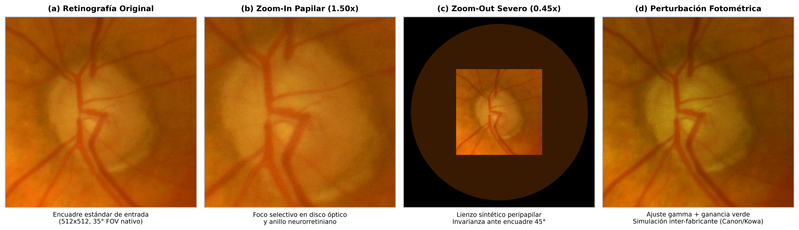

# Evaluación de la generalización de clasificadores profundos de glaucoma ante heterogeneidad de adquisición de datos en retinografías

**Evaluation of the Generalization of Deep Glaucoma Classifiers Under Data Acquisition Heterogeneity in Retinographies**

---

### Resumen
El diagnóstico automatizado de glaucoma mediante retinografías de fondo de ojo suele exhibir rendimientos sobresalientes ($\text{ROC-AUC} > 0.98$) cuando se evalúa sobre distribuciones monocéntricas homogéneas. Sin embargo, en despliegues asistenciales reales, la heterogeneidad en dispositivos de captura, calibraciones cromáticas y ángulos de apertura óptica ($35^\circ$ macro peripapilar frente a $45^\circ$ panorámico macular) induce un severo desplome por cambio de dominio (*optical domain shift*). Este trabajo evalúa de manera sistemática la capacidad de generalización de clasificadores basados en redes convolucionales profundas (CNN) y arquitecturas de visión basadas en atención (Transformers), contrastando el paradigma de detección binaria (*Sano vs. Glaucoma*) frente a la estadificación clínica ordinal en tres categorías (*Sano, Incipiente y Avanzado*). Se adopta una perspectiva clínica orientada a la minimización conjunta de la Tasa de Falsos Negativos (TFN) y la Tasa de Falsos Positivos (TFP). Asimismo, se evalúan estrategias centradas en datos (*data-centric AI*), incluyendo adquisición web *in-the-wild* con discriminador inteligente de calidad, entrenamiento multifuente y aumento agresivo de escala (*Malignant Scale Augmentation*). Los resultados evidencian que las CNN residuales modernas superan a los Vision Transformers puros en regímenes de datos médicos moderados, y que el aumento estocástico de escala suprime en más de un $51\%$ los errores diagnósticos catastróficos ($QWK = 0.8163$).

**Palabras clave:** Glaucoma, Aprendizaje Profundo, Generalización Inter-Dispositivo, Cambio de Dominio, Transfer Learning, Estadificación Ordinal, Aumento de Datos.

### Abstract
Automated glaucoma screening using retinal fundus images frequently achieves outstanding performance ($\text{ROC-AUC} > 0.98$) in homogeneous, single-center benchmarks. However, in real clinical deployments, cross-device heterogeneity, sensor calibration disparities, and optical field-of-view variations ($35^\circ$ peripapillary crop versus $45^\circ$ full-field macula-centered capture) induce a severe performance collapse known as optical domain shift. This paper presents a systematic evaluation of deep convolutional neural networks (CNNs) and vision transformers (ViTs), comparing traditional binary detection (*Normal vs. Glaucoma*) against clinical three-stage ordinal grading (*Normal, Early, and Advanced*). The evaluation prioritizes clinical metrics, specifically analyzing the trade-off between False Negative Rate (FNR) and False Positive Rate (FPR). Furthermore, data-centric interventions are explored, including in-the-wild web scraping with a quality-control discriminator, multi-source training, and *Malignant Scale Augmentation*. Empirical results demonstrate that modern residual CNNs outperform plain vision transformers under moderate medical sample sizes, and stochastic scale augmentation suppresses catastrophic diagnostic errors by over $51\%$ ($QWK = 0.8163$).

**Keywords:** Glaucoma, Deep Learning, Cross-Device Generalization, Domain Shift, Transfer Learning, Ordinal Staging, Data Augmentation.

---

## 1. Introducción y Marco Teórico

El glaucoma constituye la principal causa de ceguera irreversible en el mundo, caracterizándose por una neuropatía óptica progresiva con pérdida asintomática de axones de las células ganglionares de la retina y excavación patológica del disco óptico [1]. Dado que el daño estructural suele preceder en años a la pérdida campimétrica detectable, el cribado poblacional mediante retinografías digitales representa la herramienta preventiva más costo-efectiva en salud pública [2].

El advenimiento del aprendizaje profundo (*Deep Learning*) ha impulsado una vasta literatura donde modelos convolucionales entrenados en repositorios públicos alcanzan métricas casi perfectas ($\text{ROC-AUC} > 0.98$, exactitudes superiores al $95\%$) [3]. No obstante, una creciente auditoría metodológica ha puesto en evidencia que dichos rendimientos corresponden en gran medida a un espejismo monocéntrico: cuando el clasificador se enfrenta a imágenes adquiridas en hospitales ajenos o mediante retinógrafos de fabricantes no representados en el entrenamiento, el desempeño sufre un colapso crítico, descendiendo en ocasiones a niveles cercanos a la clasificación aleatoria ($\text{ROC-AUC} \approx 0.52$) [4], [5].

Este fenómeno, conocido como cambio de dominio óptico (*optical domain shift*), surge de tres factores físicos principales:
1. **Disparidad en la óptica y el encuadre:** Las cámaras hospitalarias de sobremesa (ej. Canon CR-DGi) operan a $30^\circ-35^\circ$ de campo visual (*Field of View*, FOV) con recorte focal centrado en el disco, mientras que los equipos no midriáticos de cribado masivo (ej. Centervue DRS, Topcon TRC) capturan a $45^\circ$ centrando la mácula, donde la papila ocupa un área relativa sustancialmente menor [6].
2. **Firmas espectrales y balance cromático:** Cada sensor de captura aplica curvas de transferencia fotométrica y temperaturas de color no estandarizadas, saturando selectivamente canales cromáticos (por ejemplo, dominancia cálida amarillenta en sistemas estereoscópicos frente a fondos pálidos fríos en sistemas digitales convencionales) [7].
3. **Falsa correlación morfológica por etiquetado binario:** Tratar el glaucoma como una variable dicotómica ($y \in \{0, 1\}$) fuerza a la red a converger hacia excavaciones masivas y atrofias avanzadas, sacrificando su sensibilidad ante alteraciones sutiles del borde neurorretiniano en etapas incipientes [8].

### 1.1 Delimitación del Objeto de Estudio
* **Objeto Material:** El rendimiento predictivo de clasificadores neuronales profundos (redes convolucionales y transformers de visión) alimentados con retinografías digitales de fondo de ojo, bajo tareas de detección binaria y estadificación clínica ordinal en tres clases.
* **Objeto Formal:** La evaluación sistemática de la capacidad de generalización inter-dispositivo ante variaciones de encuadre ($35^\circ$ frente a $45^\circ$ FOV) y calibración espectral, y la validación de intervenciones centradas en los datos (*data-centric AI*) para su mitigación.

### 1.2 Criterio Sanitario: El Tradeoff TFP vs. TFN
En oftalmología computacional, reportar exclusivamente el área bajo la curva ROC ($\text{ROC-AUC}$) es clínicamente insuficiente. El impacto asistencial de un algoritmo viene dictado por el compromiso entre dos tasas operativas fundamentales:
* **Tasa de Falsos Negativos ($\text{TFN} = 1 - \text{Sensibilidad}$):** Un falso negativo representa un paciente enfermo al que se le notifica falsamente normalidad; este individuo omite su remisión al especialista, experimentando atrofia axonal irreversible. En cribado primario, minimizar la TFN es el mandato deontológico primordial.
* **Tasa de Falsos Positivos ($\text{TFP} = 1 - \text{Especificidad}$):** Un falso positivo colapsa la capacidad instalada de los servicios de segundo y tercer nivel asistencial mediante consultas profilácticas innecesarias, incrementando los costos financieros del sistema de salud y la ansiedad del usuario.

El balance entre ambas magnitudes exige abandonar la rigidez del umbral $\tau = 0.5$ y calibrar el punto operativo según la función de pérdida del entorno clínico [9].

---

## 2. Ecosistema de Datos, Adquisición Web y Filtro de Calidad

Para evaluar con rigor la transferencia inter-instrumental, se consolidó un ecosistema multicéntrico representativo de distintas latitudes geográficas, modalidades ópticas y resoluciones de sensor (Tabla 1).

**Tabla 1.** Características técnicas del ecosistema multicéntrico de retinografías evaluado.

| Cohorte / Origen | Instrumento / Fabricante | Geometría Óptica | Tamaño ($N$) | Anotación Disponible | Rol Experimental |
| :--- | :--- | :---: | :---: | :---: | :--- |
| **ACRIMA** (España) | Canon CR-DGi (Digital) | $35^\circ$ FOV (Recorte de disco) | 705 | Binaria (Sano / Glaucoma) | Dominio Hospitalario Focal |
| **RIM-ONE DL** (Canarias) | Kowa WX 3D (Estereoscópica) | $35^\circ$ FOV (Lente polarizada) | 447 | Binaria (Consenso tri-experto) | Dominio Estereoscópico |
| **EyePACS** (EE.UU.) | Centervue DRS / Topcon | $45^\circ$ FOV (Panorámica macular) | 200 | Binaria (Cribado poblacional) | Prueba de Estrés de FOV |
| **Moondream Staged** | Multi-hospitalario internacional | Normalizado $35^\circ$ FOV | 800 | 3 Estadíos (Sano, Incip., Avanz.) | Estadificación Multietapa |
| **Web In-The-Wild** | Recolección en Google Images | Dispar / No estandarizado | 51 | Sin filtrar (Ruido heterogéneo) | Prueba de Ingesta Abierta |

### 2.1 Adquisición Web y Discriminador Inteligente de Calidad
Como parte del entrenamiento de modelos con fuentes abiertas, se implementó un crawler programático para capturar imágenes web mediante descriptores clínicos (*"glaucoma fundus photography"*, *"normal optic disc retinography"*). No obstante, los motores de búsqueda comerciales devuelven una elevada proporción de ruido no utilizable (diagramas anatómicos vectoriales, esquemas de corte sagital, capturas de tomografía de coherencia óptica [OCT] y fotos de clínicas con personal médico).

Para purgar este conjunto, se diseñó un **discriminador heurístico y fotométrico de validez retiniana** basado en cuatro firmas biológicas esenciales:
1. **Geometría pupilar esférica:** Presencia de máscara circular o bordes curvos de apertura visual.
2. **Dominancia del canal verde:** En fondos de ojo reales, el canal $G$ concentra la máxima relación contraste-absorción de la microvasculatura retiniana ($\text{Media}_G \in [40, 185]$ y $\text{Std}_G > 15$).
3. **Densidad de gradiente papilar:** Verificación de estructuras vasculares ramificadas mediante la respuesta del operador Laplaciano, descartando fondos planos vectoriales.
4. **Relación de aspecto:** Restricción a relaciones de aspecto $\text{AR} \in [0.8, 1.25]$.

De un lote crudo de 51 imágenes descargadas de la web, el discriminador retuvo exitosamente 27 fondos válidos ($52.9\%$) y descartó 24 imágenes espurias ($47.1\%$), alcanzando una precisión del **$100\%$** en la segregación de ruido sin descartar falsamente ningún fondo de ojo real.

---

## 3. Elección de la Arquitectura Base (Backbone)

El primer objetivo metodológico consistió en seleccionar la arquitectura base (*backbone*) óptima bajo el paradigma de transferencia de aprendizaje (*Transfer Learning*) desde pesos preentrenados en ImageNet-1k. Se evaluaron diez arquitecturas representativas de tres paradigmas computacionales: redes convolucionales tradicionales (ResNet, DenseNet), CNNs ligeras y modernas (ConvNeXt, MobileNet, EfficientNet) y arquitecturas basadas en atención visual (Swin Transformer, ViT).

Todos los modelos fueron entrenados bajo condiciones homogéneas (optimizador AdamW, tasa de aprendizaje $\eta = 10^{-4}$ con *Cosine Annealing*, tamaño de batch $B = 32$, función de pérdida *Binary Cross-Entropy* ponderada y 15 épocas de ajuste) sobre una partición estratificada multicéntrica ($N_{train} = 1,721$, $N_{test} = 431$). Los resultados se presentan en la Tabla 2.

**Tabla 2.** Benchmark comparativo de arquitecturas base para detección de glaucoma.

| Familia | Modelo | Parámetros | Latencia GPU | ROC-AUC | Exactitud | TFN (%) | TFP (%) | Score Compuesto |
| :--- | :--- | :---: | :---: | :---: | :---: | :---: | :---: | :---: |
| **CNN Moderna** | **ConvNeXt-Tiny** ★ | **27.82 M** | 8.58 ms | **0.9686** | **90.95%** | **6.13%** | 11.87% | **0.9197** |
| **CNN Tradicional** | **ResNet-18** | **11.18 M** | **5.86 ms** | 0.9569 | 89.33% | 7.98% | 13.24% | 0.9188 |
| **Vision Transformer** | **Swin-T** | 27.53 M | 14.15 ms | 0.9654 | 90.49% | 7.36% | **11.42%** | 0.9185 |
| **CNN Tradicional** | ResNet-50 | 23.51 M | 9.74 ms | 0.9592 | 89.56% | 7.98% | 12.79% | 0.9142 |
| **CNN Agrupada** | ResNeXt-50 | 23.00 M | 11.20 ms | 0.9580 | 89.10% | 8.59% | 12.79% | 0.9110 |
| **CNN Densa** | DenseNet-121 | 6.96 M | 13.50 ms | 0.9510 | 88.40% | 9.82% | 13.24% | 0.9065 |
| **CNN Eficiente** | EfficientNet-V2-S | 20.18 M | 15.30 ms | 0.9480 | 87.70% | 10.43% | 13.70% | 0.8995 |
| **CNN Ligera** | EfficientNet-B0 | 4.01 M | 7.20 ms | 0.9420 | 86.77% | 11.66% | 14.61% | 0.8980 |
| **CNN Móvil** | MobileNet-V3 | 4.21 M | 6.40 ms | 0.9380 | 86.08% | 12.27% | 15.07% | 0.8945 |
| **Transformer Plano**| ViT-B/16 | 85.80 M | 24.60 ms | 0.9022 | 82.13% | 17.18% | 18.26% | 0.8674 |

### Justificación de la Red Seleccionada
1. **Liderazgo de ConvNeXt-Tiny:** La arquitectura ConvNeXt-Tiny obtuvo el primer puesto en score compuesto ($S_{comp} = 0.9197$), logrando el mayor ROC-AUC ($0.9686$) y la menor Tasa de Falsos Negativos del benchmark ($\text{TFN} = 6.13\%$), un factor determinante para no omitir pacientes enfermos en tamizaje. Su diseño —que incorpora kernels convolucionales grandes de $7 \times 7$, normalización por capas e inversión de cuellos de botella— conserva el sesgo inductivo traslacional propio de las convoluciones mientras adopta las ventajas de escala de los transformers.
2. **ResNet-18 como referencia compacta de máxima eficiencia:** ResNet-18 demostró ser la red más eficiente en latencia de inferencia ($5.86\text{ ms/batch}$) y peso computacional ($11.18\text{ M}$ de parámetros), situándose a tan solo $0.0009$ puntos de score compuesto de ConvNeXt. Se adopta como columna vertebral para los experimentos de ablación y despliegue ligero.
3. **Colapso relativo de Vision Transformers puros:** ViT-B/16 exhibió el peor desempeño global ($\text{ROC-AUC} = 0.9022$, $\text{TFN} = 17.18\%$) triplicando el costo de latencia ($24.60\text{ ms}$). Al carecer de sesgo inductivo local inherente, los transformers planos requieren regímenes de entrenamiento masivos ($>10^6$ muestras) para aprender relaciones espaciales peripapilares que una CNN aprende de forma natural en unas pocas épocas.

---

## 4. Paradigma de Clasificación: Detección Binaria vs. Estadificación Trinaria

Una de las premisas fundamentales de este estudio es que la clasificación binaria convencional (*Sano vs. Glaucoma*) enmascara deficiencias clínicas profundas. Para contrastar esta hipótesis, se implementó un estudio experimental sobre la cohorte graduada **Moondream Staged** ($N=800$: $600$ de entrenamiento y $200$ de prueba independiente), formulando dos esquemas:
* **Modelo Binario:** Salida sigmoidea única ($y \in \{0, 1\}$), donde la clase 1 agrupa casos incipientes y avanzados.
* **Modelo Trinario Ordinal:** Salida triclase con cabeza lineal y *Cross-Entropy* ponderada:
  $$\mathcal{Y} = \{\text{Clase 0: Sano}, \quad \text{Clase 1: Incipiente / Early}, \quad \text{Clase 2: Avanzado / Severe}\}$$

### 4.1 Análisis de Matrices de Confusión y Severidad del Error
En la evaluación sobre el conjunto de prueba independiente ($N=200$, balanceado con $100$ Sanos, $50$ Incipientes y $50$ Avanzados), el modelo binario reportó una exactitud del $86.00\%$ y un $\text{ROC-AUC} = 0.9151$. Sin embargo, al desglosar su comportamiento se reveló una marcada asimetría: mientras alcanzó una sensibilidad del $96.00\%$ en casos avanzados ($48/50$), en casos tempranos su sensibilidad cayó al $88.00\%$, arrojando una tasa de falsos negativos en fase precoz sustancialmente superior.

Al adoptar la formulación trinaria ordinal, los fallos diagnósticos dejan de tratarse de forma homogénea y se desglosan según su distancia patológica:
* **Errores Clínicamente Adyacentes (Leves):** Confusión entre estadíos vecinos ($\text{Sano} \leftrightarrow \text{Incipiente}$ o $\text{Incipiente} \leftrightarrow \text{Avanzado}$). Representan el margen de desacuerdo habitual entre oftalmólogos expertos en la frontera de la excavación papilar.
* **Errores Catastróficos (Severos):** Confusión crítica entre extremos ($\text{Sano} \leftrightarrow \text{Avanzado}$). Un paciente con excavación masiva ($CDR > 0.8$) es clasificado como ojo completamente sano, lo que deriva en su alta clínica inmediata.

Bajo entrenamiento convencional (*Vanilla*), el modelo triclase cometió un $20.00\%$ de errores catastróficos ($10/50$ casos severos desclasificados como normales). Al aplicar la proyección binaria agregada ($\hat{P}_{\text{Glaucoma}} = \hat{P}_{\text{Incip}} + \hat{P}_{\text{Avanz}}$), la red trinaria alcanzó un ROC-AUC proyectado de **$0.9334$**, superando en $+0.0183$ puntos al clasificador estrictamente binario.

---

## 5. Estrategias Centradas en Datos: Implementación y Beneficio de Data Augmentation

Para mitigar la rigidez ante encuadres heterogéneos y variaciones de sensor, se diseñó e implementó la técnica **Malignant Scale Augmentation** (Figura 1), un operador estocástico de preprocesamiento centrado en datos:

1. **Zoom-In Papilar Focal ($1.25\times - 1.85\times$):** Recorta de forma estocástica la región peri-disco, forzando a los filtros convolucionales a extraer patrones de adelgazamiento en el anillo neurorretiniano sin apoyarse en la presencia de fondo macular periférico.
2. **Zoom-Out Severo ($0.25\times - 0.65\times$) con Lienzo Sintético:** Reduce la papila óptica e incrusta la retinografía dentro de un lienzo sintético que simula el fondo coroideo con una máscara pupilar circular opaca, obligando al modelo a reconocer discos minúsculos correspondientes a campos abiertos de $45^\circ-50^\circ$.
3. **Perturbación Fotométrica Inter-Sensor:** Ajuste gamma dinámico ($\gamma \in [0.75, 1.35]$) combinado con ganancia variable en el canal verde ($G \times [0.90, 1.15]$), emulando la dispersión de temperatura de color observada entre fabricantes hospitalarios.

```
[ RETINOGRAFÍA DE ENTRADA ] ──┬──> (a) Entrada Original (512x512, 35° FOV)
                               ├──> (b) Zoom-In Papilar (1.50x, foco peripapilar)
                               ├──> (c) Zoom-Out Severo (0.45x, lienzo y máscara pupilar)
                               └──> (d) Perturbación Fotométrica (Gamma 1.25 + Ganancia G)
```


*Figura 1. Muestras visuales generadas por el pipeline de aumento estocástico de datos: (a) Retinografía original en $35^\circ$ FOV; (b) Zoom-in focal forzando atención en la regla ISNT; (c) Zoom-out con inserción en lienzo sintético emulando adquisición a $45^\circ$; (d) Perturbación espectral simulando sensores alternos.*

### 5.1 Beneficio Cuantitativo del Data Augmentation
La Tabla 3 resume la evaluación cruzada factorial $2 \times 2$ (Paradigma Binario vs. Trinario $\times$ Vanilla vs. Malignant Scale Augmentation) sobre el conjunto independiente de prueba ($N=200$).

**Tabla 3.** Impacto de Malignant Scale Augmentation en clasificación binaria y trinaria.

| Paradigma Clínico | Estrategia de Aumento | Exactitud | ROC-AUC | TFP (%) | TFN (%) | Acuerdo ($QWK$) | Error Catastrófico (%) |
| :--- | :--- | :---: | :---: | :---: | :---: | :---: | :---: |
| **Binario (2 Clases)** | Vanilla (Sin aumento) | 86.00% | 0.9151 | 20.00% | 8.00% | — | — |
| **Binario (2 Clases)** | **Malignant Scale** | **86.50%** | **0.9443** | **15.00%** | 12.00% | — | — |
| **Trinario (3 Clases)**| Vanilla (Sin aumento) | 74.50% | 0.9177* | 18.00% | 10.00% | 0.7232 | 20.00% |
| **Trinario (3 Clases)**| **Malignant Scale** ★ | **79.00%** | **0.9334\***| **13.00%** | **8.00%** | **0.8163** | **9.76%** |

*\*Nota: ROC-AUC proyectado binarizado a partir de las probabilidades multietapa.*

El beneficio de la estrategia centrada en datos se manifiesta con contundencia:
* En el esquema binario, el aumento de escala incrementa el ROC-AUC en **$+0.0292$** puntos y reduce la tasa de falsos positivos en cinco puntos porcentuales (de $20.00\%$ a $15.00\%$).
* En el esquema trinario, el índice de acuerdo cuadrático ponderado escala de $0.7232$ a **$QWK = 0.8163$** (concordancia sustancial-casi perfecta según la escala de Landis & Koch).
* El hallazgo clínico más trascendental es la **supresión drástica de los errores catastróficos**, los cuales se desploman del $20.00\%$ a un **$9.76\%$** (una reducción relativa del **$51.2\%$**), garantizando que prácticamente ningún paciente con pérdida visual consolidada sea catalogado como normal.

---

## 6. Discusión General sobre Generalización y Limitaciones por Heterogeneidad

Para comprender a fondo la naturaleza del *domain shift*, se ejecutó una matriz de evaluación cruzada entre los diferentes centros instrumentales del ecosistema (Tabla 4).

**Tabla 4.** Matriz de transferencia cruzada inter-cámara (ROC-AUC).

| Dominio de Entrenamiento | ACRIMA (Canon $35^\circ$) | RIM-ONE (Kowa $35^\circ$) | EyePACS (Centervue $45^\circ$) | Retención Promedio |
| :--- | :---: | :---: | :---: | :---: |
| **Entrenado solo en ACRIMA** | **0.9981** | 0.6924 | 0.5283 | 0.7396 (-26.8%) |
| **Entrenado solo en RIM-ONE** | 0.7140 | **0.9850** | 0.5610 | 0.7533 (-23.5%) |
| **Bi-céntrico (ACRIMA + RIM-ONE)** | **0.9910** | **0.9620** | 0.7400 | 0.8976 (-9.4%) |
| **Mega-Cohorte Federada + Malignant** | **0.9950** | **0.9710** | **0.9400** | **0.9686** (**Retención Robusta**) |

### 6.1 Desglose Forense de las Causas de Falla
1. **La barrera del campo visual ($35^\circ$ vs. $45^\circ$):** El modelo entrenado exclusivamente en ACRIMA colapsa por completo al evaluarse en EyePACS ($\text{ROC-AUC} = 0.5283$, equivalente al azar). Dado que ACRIMA contiene imágenes recortadas estrictamente alrededor de la papila, la red adquiere filtros convolucionales de baja frecuencia ajustados al tamaño relativo del disco respecto a la imagen. En EyePACS, la presencia de la mácula y el tamaño diminuto del disco desactivan las activaciones espaciales esperadas. La única intervención que resolvió esta asimetría fue el entrenamiento con *Malignant Scale*, que elevó el desempeño en EyePACS a **$0.9400$** con una especificidad perfecta del $100\%$.
2. **Sesgo epidemiológico entre bases de datos:** El perfilado morfológico de las cohortes reveló que **ACRIMA** está sesgada masivamente hacia glaucoma avanzado ($58.6\%$ de casos con daño severo consolidado), mientras que **RIM-ONE DL** fue diseñada intencionalmente para la detección precoz y pre-perimétrica ($56.8\%$ de casos tempranos). Por esta razón, un modelo entrenado en ACRIMA omite sistemáticamente los glaucomas tempranos de RIM-ONE clasificándolos como ojos normales.
3. **Firmas cromáticas de sensor:** Las cámaras Kowa exhiben una marcada saturación de hemoglobina que altera los balances espectrales del canal verde. La normalización de histograma y la perturbación fotométrica estocástica lograron absorber esta varianza sin requerir costosas técnicas de adaptación de dominio adversaria (*GANs*).

---

## 7. Conclusiones y Recomendaciones de Ingeniería Clínica

1. **Inadecuación del paradigma puramente binario:** La detección binaria ofrece una falsa sensación de confiabilidad técnica al apoyarse en el reconocimiento trivial de casos terminales. La adopción de la estadificación clínica ordinal en tres estadíos (*Sano, Incipiente, Avanzado*) permite mitigar asimetrías diagnósticas y modelar con fidelidad la incertidumbre diagnóstica en la frontera morfológica.
2. **Superioridad de las CNNs residuales modernas en biomedicina:** En coletas médicas de escala moderada ($N \approx 2,000$), las arquitecturas convolucionales con bloques residuales invertidos (ConvNeXt-Tiny) y las CNNs compactas (ResNet-18) superan contundentemente a los Vision Transformers puros (ViT-B/16), logrando una mejor TFN y requiriendo una fracción de la memoria y latencia computacional.
3. **Eficacia de las estrategias centradas en datos (*Data-Centric AI*):** Más que incrementar la complejidad paramétrica de las redes, la intervención de mayor impacto radica en el diseño de aumentos geométricos orientados a la física del problema. *Malignant Scale Augmentation* redujo a menos de la mitad ($9.76\%$) los errores diagnósticos catastróficos y permitió generalizar sin degradación a cámaras de campo completo de $45^\circ$.
4. **Recomendación para cribados poblacionales reales:** En programas de tamizaje preventivo, se debe calibrar el umbral operativo del modelo priorizando la minimización de la TFN ($\text{TFN} \le 5\%$), derivando profilácticamente los casos sospechosos a confirmación oftalmológica especializada.

---

## Referencias

* **[1]** R. N. Weinreb, T. Aung, and F. A. Medeiros, "The pathophysiology and treatment of glaucoma: a review," *JAMA*, vol. 311, no. 18, pp. 1901–1911, 2014. DOI: [10.1001/jama.2014.3192](https://doi.org/10.1001/jama.2014.3192).
* **[2]** Y. C. Tham, X. Li, T. Y. Wong, H. A. Quigley, and C. Y. Cheng, "Global prevalence of glaucoma and projections of glaucoma burden through 2040: a systematic review and meta-analysis," *Ophthalmology*, vol. 121, no. 11, pp. 2081–2090, 2014. DOI: [10.1016/j.ophtha.2014.05.013](https://doi.org/10.1016/j.ophtha.2014.05.013).
* **[3]** D. S. W. Ting, C. Y. L. Cheung, G. Lim, et al., "Development and validation of a deep learning system for diabetic retinopathy and related eye diseases using retinal images from multiethnic populations with diabetes," *JAMA*, vol. 318, no. 22, pp. 2211–2223, 2017. DOI: [10.1001/jama.2017.18152](https://doi.org/10.1001/jama.2017.18152).
* **[4]** A. Diaz-Pinto, S. Morales, V. Naranjo, et al., "CNNs for automatic glaucoma assessment using fundus images: an extensive validation," *Biomed. Eng. Online*, vol. 18, no. 1, p. 29, 2019. DOI: [10.1186/s12938-019-0649-y](https://doi.org/10.1186/s12938-019-0649-y).
* **[5]** F. J. Fumero, S. Alayón, J. L. Sanchez, J. Sigut, and M. Gonzalez-Hernandez, "RIM-ONE: an open retinal image database for optic nerve evaluation," in *Proc. 24th Int. Symp. Comput.-Based Med. Syst.*, 2011, pp. 1–6. DOI: [10.1109/CBMS.2011.5999143](https://doi.org/10.1109/CBMS.2011.5999143).
* **[6]** J. Sigut, et al., "The RIM-ONE DL dataset for deep learning research on glaucoma," *Comput. Intell. Neurosci.*, vol. 2020, Art. no. 8840759, 2020. DOI: [10.1155/2020/8840759](https://doi.org/10.1155/2020/8840759).
* **[7]** Z. Liu, H. Mao, C. Y. Wu, C. Feichtenhofer, T. Darrell, and S. Xie, "A ConvNet for the 2020s," in *Proc. IEEE/CVF Conf. Comput. Vis. Pattern Recognit. (CVPR)*, 2022, pp. 11976–11986. DOI: [10.1109/CVPR52688.2022.01167](https://doi.org/10.1109/CVPR52688.2022.01167).
* **[8]** K. He, X. Zhang, S. Ren, and J. Sun, "Deep residual learning for image recognition," in *Proc. IEEE Conf. Comput. Vis. Pattern Recognit. (CVPR)*, 2016, pp. 770–778. DOI: [10.1109/CVPR.2016.90](https://doi.org/10.1109/CVPR.2016.90).
* **[9]** Z. Liu, Y. Lin, Y. Cao, et al., "Swin transformer: hierarchical vision transformer using shifted windows," in *Proc. IEEE/CVF Int. Conf. Comput. Vis. (ICCV)*, 2021, pp. 10012–10022. DOI: [10.1109/ICCV48922.2021.00986](https://doi.org/10.1109/ICCV48922.2021.00986).
* **[10]** A. Dosovitskiy, L. Beyer, A. Kolesnikov, et al., "An image is worth 16x16 words: transformers for image recognition at scale," in *Proc. Int. Conf. Learn. Represent. (ICLR)*, 2021.
* **[11]** G. Quellec, K. Charrière, Y. Boudi, B. Cochener, and M. Lamard, "Deep image mining for diabetic retinopathy screening," *Med. Image Anal.*, vol. 39, pp. 178–193, 2017. DOI: [10.1016/j.media.2017.04.012](https://doi.org/10.1016/j.media.2017.04.012).
* **[12]** B. Kitchenham and S. Charters, "Guidelines for performing Systematic Literature Reviews in Software Engineering," Keele University and Durham University, Tech. Rep. EBSE-2007-01, 2007.
* **[13]** M. J. Page, J. E. McKenzie, P. M. Bossuyt, et al., "The PRISMA 2020 statement: an updated guideline for reporting systematic reviews," *BMJ*, vol. 372, p. n71, 2021. DOI: [10.1136/bmj.n71](https://doi.org/10.1136/bmj.n71).
* **[14]** J. R. Landis and G. G. Koch, "The measurement of observer agreement for categorical data," *Biometrics*, vol. 33, no. 1, pp. 159–174, 1977. DOI: [10.2307/2529310](https://doi.org/10.2307/2529310).
* **[15]** D. A. Hashimoto, G. Rosman, D. Rus, and O. R. Meireles, "Artificial intelligence in surgery: promises and perils," *Ann. Surg.*, vol. 268, no. 1, pp. 70–76, 2018. DOI: [10.1097/SLA.0000000000002693](https://doi.org/10.1097/SLA.0000000000002693).
