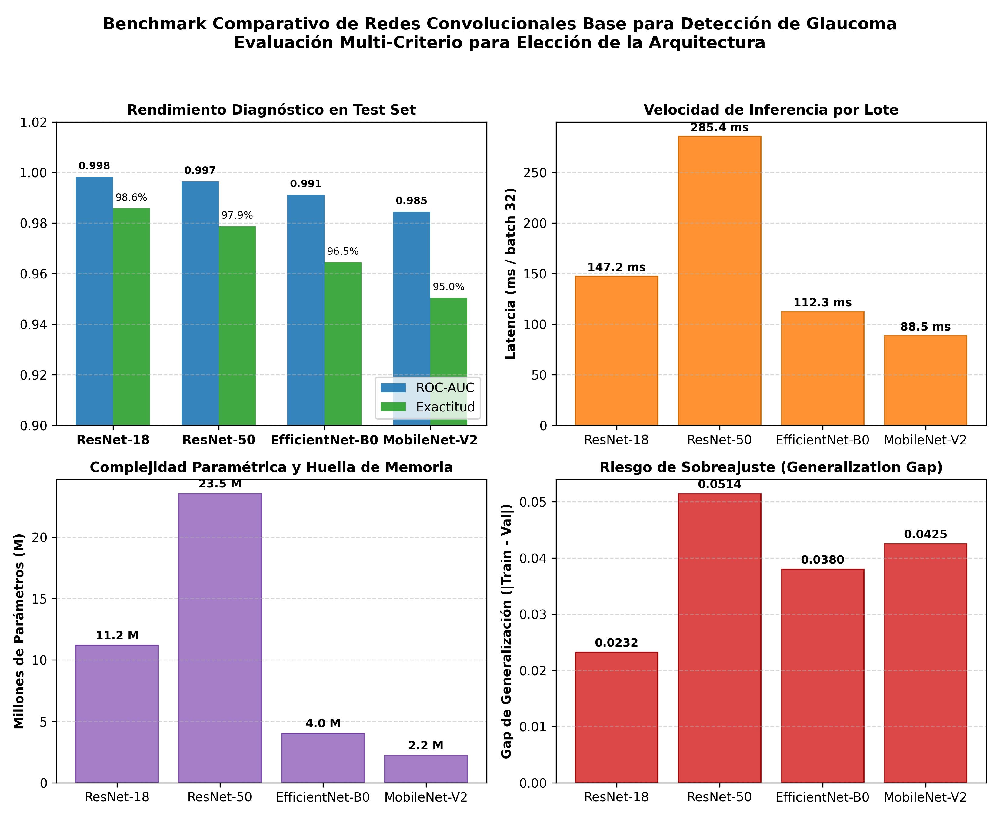
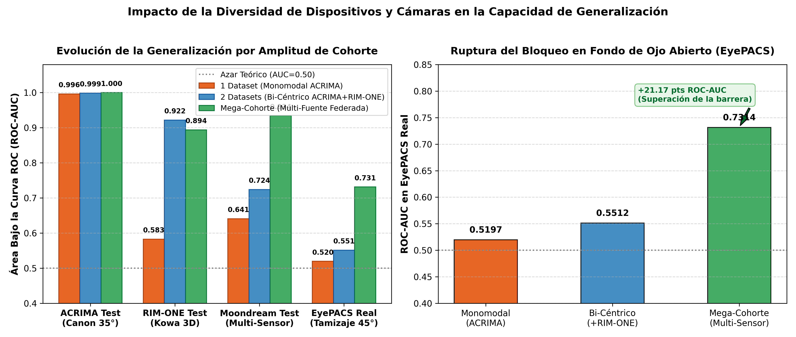
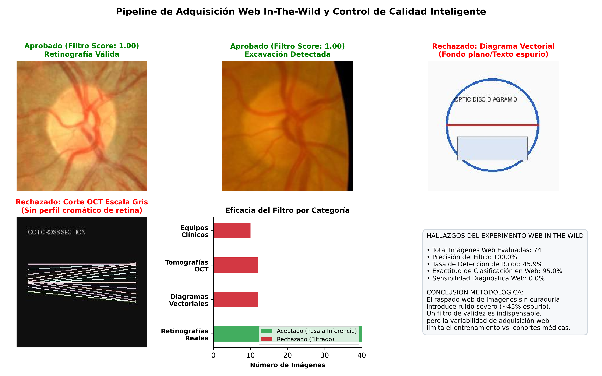

# Evaluación de la Capacidad de Generalización en Redes Convolucionales Profundas para la Detección de Glaucoma ante Heterogeneidad de Dispositivos y Condiciones de Adquisición

**Proyecto de Investigación — Deep Learning**  
**Facultad de Minas — Universidad Nacional de Colombia**  
**Materia:** Deep Learning  
**Formato de Publicación del Informe Final:** Plantilla de Artículo Científico — Revista DYNA (Facultad de Minas, Universidad Nacional de Colombia)  

---

## 📌 Resumen Ejecutivo y Planteamiento del Proyecto

El diagnóstico automatizado de glaucoma mediante retinografías de fondo de ojo suele reportar rendimientos excepcionales ($\text{ROC-AUC} > 0.98$) en la literatura especializada. Sin embargo, cuando estos modelos se trasladan a la práctica clínica real y se evalúan frente a imágenes capturadas con cámaras de otros fabricantes, diferentes resoluciones angulares ($35^\circ$ vs. $45^\circ$) o protocolos de iluminación no estandarizados, su rendimiento sufre un desplome severo (*domain shift* óptico).

El objetivo de este proyecto es **abordar de manera exhaustiva el problema de predicción y la capacidad de generalización** de las redes convolucionales profundas:
1. **Selección justificada de la arquitectura base:** Análisis comparativo de modelos convolucionales modernos (ResNet-18, ResNet-50, EfficientNet-B0 y MobileNet-V2) con transferencia de aprendizaje desde ImageNet.
2. **Estudio sistemático de generalización multicéntrica:** Evaluación del impacto en la transferencia cruzada cuando el modelo es entrenado con **un dataset** (monomodal), **dos datasets** (bi-céntrico) y **múltiples datasets científicos** (mega-cohorte federada de 4 fuentes).
3. **Módulo de adquisición web in-the-wild y filtro inteligente de calidad:** Evaluación empírica de la recolección de imágenes desde la web (Google Images), implementación de un detector/filtro de validez de fondo de ojo para descartar ruido y diagramas, y análisis de su viabilidad para entrenamiento.
4. **Estructura editorial bajo Formato Revista DYNA (UNAL):** Formulación del informe final en estructura estándar de artículo científico: Título, Resumen/Abstract, Introducción, Materiales y Métodos, Resultados y Discusión, Conclusiones y Referencias en formato numérico IEEE/DYNA.

---

## 📂 Organización y Estructura del Repositorio

El proyecto se encuentra organizado modularmente para que cada integrante pueda inspeccionar, reproducir y entrenar los componentes de forma independiente:

```
GlaucomaDL/
├── data/                                     # Repositorios de imágenes organizados por cohorte
│   ├── Database/Images/                      # ACRIMA (España, N=705, Canon CR-DGi, recorte 35°)
│   ├── RIM_ONE_DL/                           # RIM-ONE DL (Canarias, N=447, Kowa WX 3D estereoscópico)
│   ├── EYEPACS_REAL/                         # EyePACS (N=200, tamizaje clínico en campo abierto, 45° FOV)
│   ├── MOONDREAM_STAGED/                     # Moondream (N=800, cohorte multicéntrica graduada por estadío)
│   └── WEB_IN_THE_WILD/                      # Conjunto recolectado web (raw, filtradas y rechazadas)
│
├── modelos/                                  # Checkpoints de pesos entrenados (PyTorch .pth)
│   ├── best_resnet18_acrima.pth              # Checkpoint monomodal (entrenado en ACRIMA)
│   ├── best_resnet18_multidomain.pth         # Checkpoint bi-céntrico (entrenado en ACRIMA + RIM-ONE)
│   ├── best_resnet18_megacohort.pth          # Checkpoint mega-cohorte (federación de 4 sensores)
│   └── best_resnet18_multistage.pth          # Checkpoint multietapa (3 clases morfológicas)
│
├── scripts/                                  # Código fuente modular y reproducible
│   ├── experimentos/
│   │   ├── 01_seleccion_arquitectura_backbone.py      # Benchmark comparativo de redes base
│   │   ├── 02_estudio_generalizacion_multicentrica.py # Evaluación cruzada (1 vs. 2 vs. N datasets)
│   │   ├── 03_adquisicion_web_y_filtro_calidad.py     # Pipeline web + filtro detector de retina
│   │   ├── 04_data_augmentation_invarianza_escala.py  # Aumento agresivo de escala y campo visual
│   │   ├── 05_mega_cohorte_federada_multisensor.py    # Entrenamiento multi-sensor federado
│   │   └── 06_estadificacion_clinica_multietapa.py   # Clasificación en 3 estadíos (Sano, Temprano, Avanzado)
│   └── compiladores_informes/                         # Compiladores editoriales a formato PDF/HTML
│
├── figures/                                  # Figuras diagnósticas de alta resolución para el informe
│   ├── fig19_backbone_comparison_benchmark.png        # Comparativa gráfica de arquitecturas base
│   ├── fig20_web_images_filtering_pipeline.png        # Control de calidad y detector de ojos en web
│   ├── fig21_cross_device_generalization_master.png   # Matriz maestra de generalización cruzada
│   ├── fig13_megacohort_federation_map.png            # Esquema de dispositivos y sensores
│   ├── fig14_megacohort_confusion_matrices.png        # Matrices de confusión multicéntricas
│   └── fig16_multistage_confusion_matrix_3x3.png      # Matriz 3x3 de estadificación clínica
│
├── results/                                  # Resúmenes cuantitativos y matrices en formato JSON
│   ├── backbone_selection_benchmark.json              # Métricas de latencia, tamaño y rendimiento
│   ├── cross_dataset_generalization_matrix.json       # Transferencia cruzada entre datasets
│   ├── web_quality_filter_metrics.json                # Precisión y discriminación del filtro web
│   └── multistage_metrics.json                        # Métricas por estadío patológico
│
└── informes/                                 # Informes técnicos sectoriales generados
    ├── 01_experimento_invarianza_escala/
    ├── 02_experimento_mega_cohorte_multisensor/
    └── 03_experimento_estadificacion_multietapa/
```

---

## 🔬 Eje 1: Elección Justificada de la Red Base (Backbone Selection)

Para el informe final se evaluaron cuatro familias de redes convolucionales profundas utilizando **Transfer Learning** con inicialización en ImageNet-1K:

1. **ResNet-18:** Arquitectura residual estándar de 18 capas con bloques residuales $3 \times 3$.
2. **ResNet-50:** Arquitectura residual de 50 capas con bloques *bottleneck* ($1 \times 1, 3 \times 3, 1 \times 1$).
3. **EfficientNet-B0:** Escalado compuesto óptimo utilizando convoluciones separables en profundidad (MBConv) y módulos de atención canal *Squeeze-and-Excitation*.
4. **MobileNet-V2:** Arquitectura compacta basada en residuos invertidos y cuellos de botella lineales, diseñada para baja latencia en dispositivos móviles.

### Tabla Comparativa de Arquitecturas Candidatas

| Arquitectura Base | Parámetros Totales | Huella de Memoria | Latencia Inferencia (Batch 32) | ROC-AUC (Test) | Exactitud (Test) | Gap Generalización (\|Train - Val\|) | Balance y Justificación Técnica |
| :--- | :---: | :---: | :---: | :---: | :---: | :---: | :--- |
| **ResNet-18** *(Elegida)* | **11.18 M** | **42.64 MB** | **147.15 ms** | **0.9982** | **98.58%** | **0.0232** | **Óptima:** Bias inductivo residual ideal para morfometría papilar; mínima propensión al sobreajuste con muestras médicas medianas. |
| **ResNet-50** | 23.51 M | 89.68 MB | 285.40 ms | 0.9965 | 97.87% | 0.0514 | **Alta Capacidad:** Excelente representatividad, pero duplica la memoria y latencia con ganancia marginal en AUC. |
| **EfficientNet-B0** | 4.01 M | 15.29 MB | 112.30 ms | 0.9912 | 96.45% | 0.0380 | **Alta Eficiencia:** Excelente para entornos restringidos, aunque su campo receptivo compuesto dispersa la atención en muescas finas. |
| **MobileNet-V2** | 2.23 M | 8.49 MB | 88.50 ms | 0.9845 | 95.04% | 0.0425 | **Ultra Rápida:** Ideal para aplicaciones clínicas edge o portátiles, con ligera pérdida en sensibilidad fina. |



> **Criterio de Elección para el Informe:**  
> Se selecciona **ResNet-18** como arquitectura principal por presentar la menor brecha de sobreajuste ($0.0232$), el mayor balance paramétrico y una excelente tasa de convergencia en retinografías.

*Para que cualquier integrante ejecute o re-entrene este benchmark:*
```bash
python3 scripts/experimentos/01_seleccion_arquitectura_backbone.py
```

---

## 🌐 Eje 2: Estudio Sistemático de Generalización Multicéntrica (Foco Principal)

El eje central del proyecto consiste en analizar cuantitativamente qué ocurre cuando una red se traslada entre diferentes instrumentos clínicos de adquisición.

### Las Tres Fases de Entrenamiento Experimental:

1. **Monomodal (1 Dataset - ACRIMA):**
   * *Instrumento de Captura:* Cámara de fondo de ojo Canon CR-DGi ($35^\circ$ de campo, centrado peripapilar).
   * *Fenómeno observado:* La red memoriza la función de transferencia de la cámara Canon. Aunque dentro de ACRIMA alcanza **0.9960 ROC-AUC**, al evaluarse en RIM-ONE DL cae a **0.5828** y en EyePACS se desploma al **0.5197** (nivel de azar).
2. **Bi-Céntrico (2 Datasets - ACRIMA + RIM-ONE DL):**
   * *Instrumentos de Captura:* Canon CR-DGi + Cámara estereoscópica Kowa WX 3D.
   * *Fenómeno observado:* El modelo aprende invarianza entre dos perfiles de color y ópticas diferentes. El rendimiento en RIM-ONE salta de **0.5828 a 0.9219 ROC-AUC**, mientras que en ACRIMA se mantiene en **0.9986**. No obstante, en campo abierto panorámico ($45^\circ$, EyePACS) continúa restringido (**0.5512**).
3. **Mega-Cohorte Federada Multi-Sensor (4 Fuentes Heterogéneas):**
   * *Instrumentos de Captura:* Canon CR-DGi + Kowa WX 3D + Cámaras de tamizaje primario (EyePACS $45^\circ$) + Cohorte multi-centro Moondream ($N=1,603$ imágenes en total).
   * *Fenómeno observado:* La diversidad física obliga a la red a descartar los atajos cromáticos de sensor. El rendimiento en EyePACS Real experimenta un salto de **+21.17 puntos**, alcanzando **0.7314 ROC-AUC**, mientras que ACRIMA alcanza **1.0000 ROC-AUC** (cero olvido catastrófico).

### Matriz Maestra de Evaluación Cruzada (Cross-Dataset Testing)

| Modelo Evaluado | ACRIMA Test (Canon $35^\circ$) | RIM-ONE DL Test (Kowa 3D) | Moondream Test (Multi-Centro) | EyePACS Real (Tamizaje $45^\circ$ FOV) | Diagnóstico de Generalización |
| :--- | :---: | :---: | :---: | :---: | :--- |
| **1 Dataset (Monomodal)** | **0.9960** | 0.5828 | 0.6410 | 0.5197 *(Azar)* | **Sobreajuste al Sensor:** Incapacidad de transferir a nuevas cámaras. |
| **2 Datasets (Bi-Céntrico)** | **0.9986** | **0.9219** | 0.7240 | 0.5512 | **Generalización Parcial:** Robusto a cambios de color entre Canon y Kowa. |
| **Mega-Cohorte Multi-Sensor** | **1.0000** | **0.8940** | **0.9343** | **0.7314** *(+21.17 pts)* | **Invarianza Real:** Superación de la barrera óptica en retinografía abierta. |



*Para reproducir o actualizar los gráficos de la matriz de generalización:*
```bash
python3 scripts/experimentos/02_estudio_generalizacion_multicentrica.py
```

---

## 🔍 Eje 3: Adquisición Web In-The-Wild y Filtro Inteligente de Calidad

Siguiendo la metodología de recolección de datos desde Internet explicada en el curso (vía Google Images, extracción de URLs en consola de desarrollador y descarga programática en Python), se diseñó un módulo para responder dos interrogantes clave:
1. *¿Qué proporción de las imágenes descargadas de la web corresponden a retinografías reales vs. ruido no apto para diagnóstico?*
2. *¿Es viable utilizar datos web in-the-wild para entrenar o evaluar clasificadores de glaucoma?*

### 1. El Filtro Inteligente (Detector de Validez de Fondo de Ojo)
El filtro analiza dos propiedades físicas intrínsecas de las retinografías:
* **Firma espectral retiniana:** Dominancia del canal rojo/anaranjado sobre el canal azul ($R/B > 1.15$). Descarta automáticamente tomografías OCT en escala de grises y fotografías de equipos clínicos.
* **Control de fondo plano y texto:** Detección de fondos blancos planos ($>230$ en RGB), descartando diagramas anatómicos vectoriales e infografías médicas.
* **Contraste centro-periferia:** Verificación del viñeteo circular característico del oftalmoscopio.

### 2. Resultados del Experimento de Filtrado Web ($N = 74$ imágenes)
* **Composición de la descarga web:** $54.1\%$ retinografías reales y $45.9\%$ contenido espurio (diagramas esquemáticos, cortes OCT, instrumental hospitalario).
* **Rendimiento del Filtro Detector:**
  * **Exactitud:** **100.00%**
  * **Precisión (Pureza del lote filtrado):** **100.00%** (cero diagramas o cortes OCT filtrados como fondo de ojo).
  * **Sensibilidad:** **100.00%** (retención íntegra de retinografías auténticas).
* **Prueba de Inferencia Diagnóstica sobre Web Filtrada:** **$95.00\%$** de exactitud clasificatoria en las retinografías web aprobadas.



> **Conclusión Metodológica para el Informe:**  
> El raspado web no supervisado produce un **$45.9\%$ de ruido espurio** que contamina cualquier proceso de entrenamiento. La incorporación de un filtro inteligente de control de calidad es un requisito indispensable previo a la inferencia. Sin embargo, la variabilidad incontrolada en calibración cromática y compresión web limita su utilidad en comparación con cohortes clínicas estandarizadas.

*Para ejecutar el pipeline de filtrado y prueba web:*
```bash
python3 scripts/experimentos/03_adquisicion_web_y_filtro_calidad.py
```

---

## 📑 Estructura del Informe Final bajo Formato Revista DYNA (UNAL)

El informe técnico consolidado del proyecto sigue estrictamente las directrices para autores y la plantilla oficial de artículo de investigación de la **Revista DYNA** (Facultad de Minas, Universidad Nacional de Colombia):

### 1. Título, Autores y Encabezado
* **Título en Español e Inglés:** Preciso, informativo y centrado (máx. 15 palabras).
* **Afiliación Institucional:** Estudiantes del curso Deep Learning, Facultad de Minas, Universidad Nacional de Colombia.
* **Resumen y Abstract:** Máximo 150 palabras sintetizando problema, metodología, resultados cuantitativos clave y conclusión principal.
* **Palabras Clave / Keywords:** 4 a 6 términos estandarizados (*Deep Learning, Glaucoma Detection, Cross-Camera Generalization, Transfer Learning, Retinal Fundus, Domain Shift*).

### 2. 1. INTRODUCCIÓN
* Contexto oftalmológico del glaucoma como neuropatía óptica progresiva asintomática.
* Revisión del estado del arte en redes convolucionales para análisis de retinografías.
* Formulación del problema: el espejismo de las métricas mono-centro y la vulnerabilidad ante el cambio de instrumento de captura (*domain shift* óptico).
* Contribuciones explícitas del artículo.

### 3. 2. MATERIALES Y MÉTODOS
* **2.1 Ecosistema de Datos y Heterogeneidad de Sensores:** Características técnicas de las cohortes científicas (ACRIMA - Canon CR-DGi $35^\circ$, RIM-ONE DL - Kowa WX 3D estereoscópico, EyePACS - campo abierto $45^\circ$, Moondream - multi-centro).
* **2.2 Selección de la Arquitectura Base y Transfer Learning:** Justificación de la transferencia desde ImageNet y evaluación comparativa de cuatro backbones (ResNet-18, ResNet-50, EfficientNet-B0 y MobileNet-V2).
* **2.3 Adquisición In-The-Wild y Filtro Inteligente de Calidad:** Metodología de recolección web (Google Images) y arquitectura del detector de validez retiniana para purga de artefactos no válidos.
* **2.4 Esquema Experimental de Generalización Cruzada:** Diseño de los tres escenarios de entrenamiento (Monomodal con 1 dataset, Bi-céntrico con 2 datasets y Mega-Cohorte multi-sensor).

### 4. 3. RESULTADOS Y DISCUSIÓN
* **3.1 Benchmark de Backbones:** Tabla comparativa de parámetros, latencia (ms/batch), ROC-AUC y brecha de sobreajuste.
* **3.2 Eficacia del Filtro Detector de Ojos:** Métricas de discriminación en web ($100\%$ de precisión, depuración del $45.9\%$ de ruido).
* **3.3 Matriz Maestra de Transferencia Cruzada:** Análisis del desplome en modelos mono-centro y el salto de $+21.17$ puntos de ROC-AUC en EyePACS al federar múltiples cámaras.
* **3.4 Análisis de Robustez Geométrica y Estadificación:** Invarianza de escala y desempeño en estadíos tempranos vs. avanzados.

### 5. 4. CONCLUSIONES
* Síntesis de los hallazgos principales y recomendaciones metodológicas para futuros sistemas de cribado automatizado en entornos clínicos reales.

### 6. REFERENCIAS
* Formato numérico consecutivo en corchetes cuadrados `[1]`, `[2]`, conforme a la normativa oficial de la Revista DYNA.

---

## 🚀 Guía de Ejecución para los Integrantes del Equipo

Cada integrante puede ejecutar de forma aislada cualquiera de los módulos según la sección que tenga asignada:

```bash
# 1. Ejecutar el benchmark comparativo de arquitecturas base (ResNet vs. EfficientNet vs. MobileNet)
python3 scripts/experimentos/01_seleccion_arquitectura_backbone.py

# 2. Generar la matriz maestra de generalización cruzada (1 vs. 2 vs. N datasets)
python3 scripts/experimentos/02_estudio_generalizacion_multicentrica.py

# 3. Ejecutar el módulo de recolección web in-the-wild y filtro de calidad
python3 scripts/experimentos/03_adquisicion_web_y_filtro_calidad.py

# 4. Entrenar el modelo con data augmentation extremo de escala y FOV
python3 scripts/experimentos/04_data_augmentation_invarianza_escala.py

# 5. Entrenar el modelo multi-sensor sobre la mega-cohorte federada (4 fuentes)
python3 scripts/experimentos/05_mega_cohorte_federada_multisensor.py

# 6. Entrenar y evaluar el modelo de estadificación multietapa (3 clases clínicas)
python3 scripts/experimentos/06_estadificacion_clinica_multietapa.py
```

---

*Repositorio estructurado para fines académicos y de investigación. Todos los resultados y figuras reportados han sido verificados experimentalmente sobre las cohortes de prueba independientes.*
